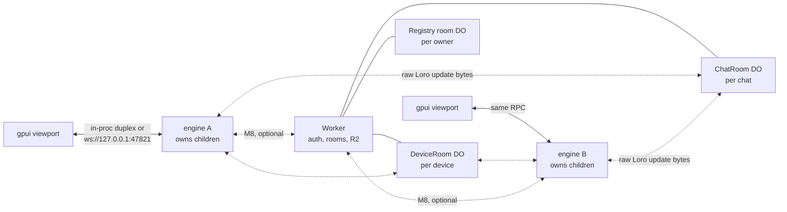
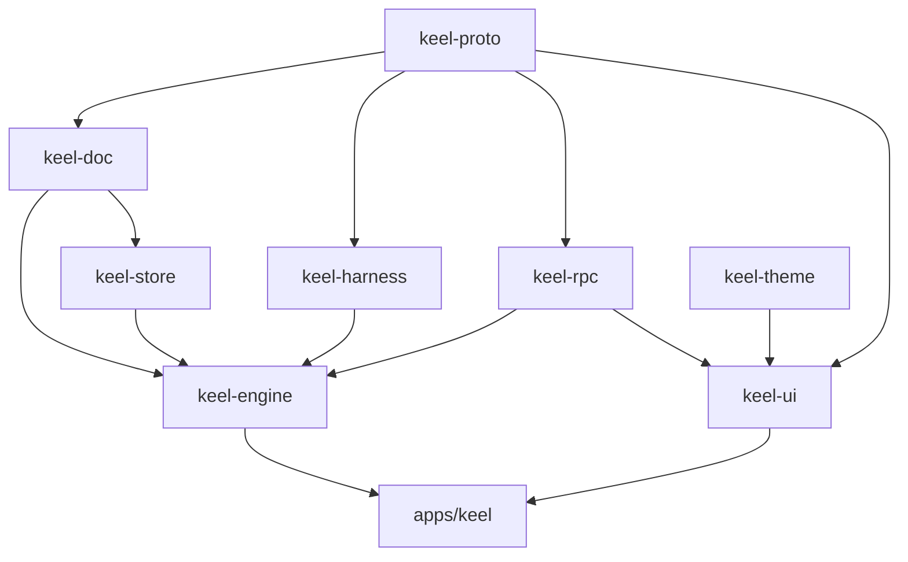
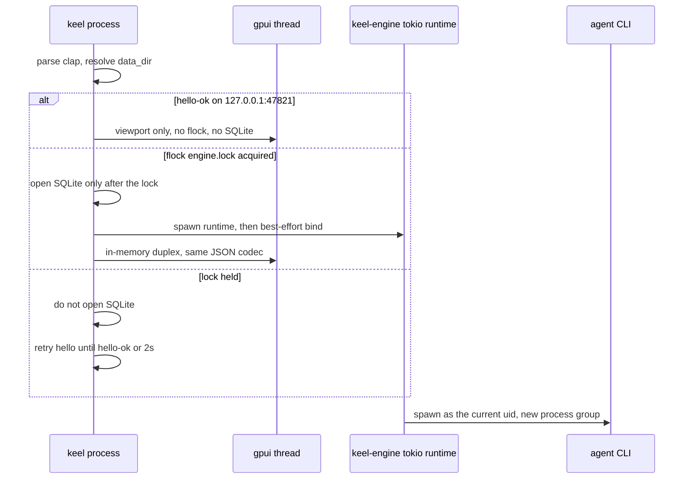
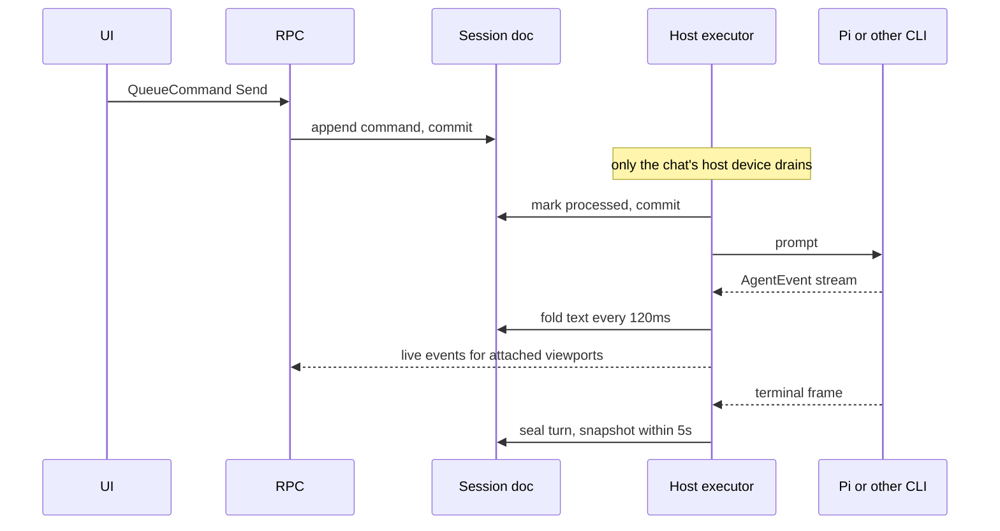
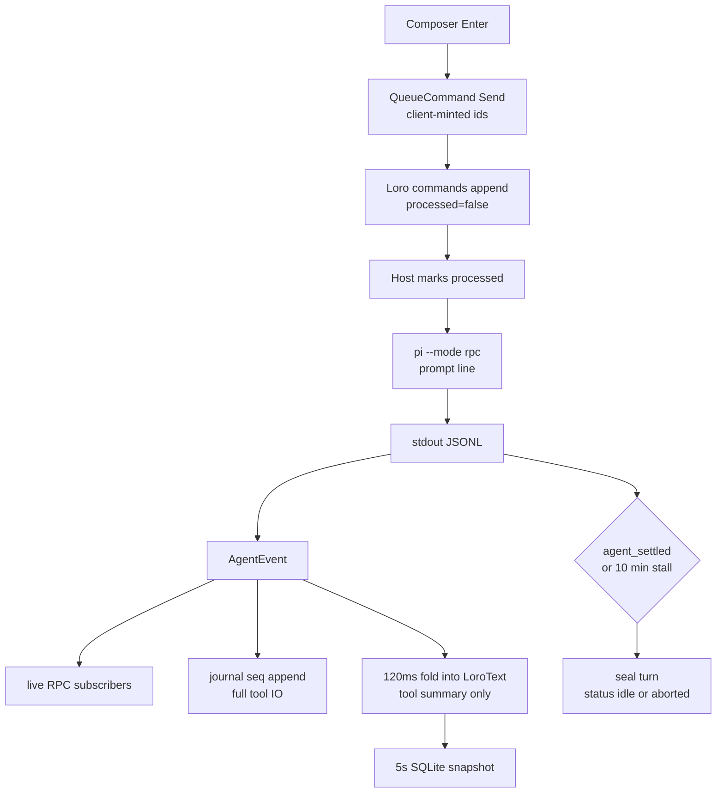

# Keel — Local-First Coding-Harness Control Plane

| Field | Value |
| --- | --- |
| Author | _unspecified_ |
| Date | 2026-10-07 |
| Status | Draft |
| Project root (created when implementation starts, not by this document) | `keel/` |
| Prior art | [Zeron](https://github.com/zeronsh/zeron) (`ARCHITECTURE.md`, workspace `Cargo.toml`, harness README, `docs/pi.md`, `docs/mcp.md`, `docs/registry-sync.md`, `docs/chat2-sync.md`, fetched 2026-10-07) and [zeron.sh](https://zeron.sh/) |
| Audience | One senior engineer implementing a greenfield repo. There is no existing crate to extend. |

> **2026-10-19: Keel is local-only.** The optional multi-device sync was removed: the `edge/` Worker, room and device-room clients, pairing login (`keel login`, `keel pairing-code`, `keel logout`), `KEEL_DEV_BEARER`, `KEEL_EDGE_URL`, and the sync/scope wiring in the engine. Local persistence stays in `crates/store` (`keel-store`, formerly `keel-sync`): the profile layout, `DocsStore`, and the Loro session and registry snapshots in `profiles/local/store.sqlite`. Sections below about sync, the edge, auth, or M8 (PR 5, 18, 19, 21) are kept as history only.

This document is the plan. It does not create the directory, the Rust workspace, or any application code. It does not fork, vendor, or copy the Zeron repository.

---

## Overview

Keel is a control plane for coding-agent CLIs running on the machine. It is not a new agent, not a model, and not a chat product of its own. One local engine owns the child processes. A native gpui window is a viewport onto that engine. Each agent has a driver that speaks that CLI's own wire and normalizes it into one `AgentEvent` stream and one transcript.

Keel is local-only. No account is required. Sessions stay on the device. (An optional multi-device sync shipped in M8 and was removed on 2026-10-19.)

The repo will be created at `keel/`. The binary is `keel`. The macOS data directory is `~/Library/Application Support/Keel/`. The localhost IPC port is **47821** (`KEEL_IPC_PORT` overrides it). Zeron's port 27654 is intentionally not reused, so both processes can run on the same machine.

Scale target for the first year: one person, one or two devices, dozens of sessions (design point: 50 index rows, warm set of 30), not thousands. A heavy agentic chat is budgeted at roughly 160 KB of session snapshot once tool bodies are summaries; the host-local run journal holds the full tool IO and is the thing that can grow into hundreds of megabytes.

---

## Background & Motivation

Coding agents run as CLIs (Pi is installed and is the daily driver). Each CLI has its own terminal UI, its own session file, and its own steering rules. What is missing is one process that can start a session in a folder, keep the child alive, record a single transcript, and later let a second machine watch the same session. That is the shape of Zeron. Keel copies the shape and the materials, not the source tree.

Keel is standalone and does not depend on external web wrappers. Pi on this machine is the official managed install: `~/.local/bin/pi` resolves to `~/.pi/agent/bin/pi`, and `pi --version` prints **1.0.4** (checked 2026-10-07). Reinstalls use `https://pi.dev/install.sh`. `npm install -g` is not an install path for Pi.

Current pain:

- A GUI or `launchd` job does not inherit the zsh PATH that finds `~/.local/bin/pi`. Discovery has to compose a login-shell PATH or the headed app reports Pi as missing.
- CLI wires disagree. Pi is JSONL RPC. Claude Code is stream-json. Codex is app-server JSON-RPC. Grok and Command Code are ACP on stdio. A single adapter in front of all of them has already been tried upstream and retired (see Key Decisions).
- Transcripts and "please keep going" commands need to survive a crash and, later, a second device. A SQLite table of messages is enough until two devices edit the same assistant text. A CRDT is the document model from day one so the local file and the future sync file are the same type.
- Putting that CRDT inside a Cloudflare Worker via `loro-wasm` is a known failure mode. Zeron measured a 1,079,986-byte session (10 messages, 426 tool parts, 85% capped tool output) and wrote up Durable Object wedges when the Worker imported the doc. Keel keeps Loro on the device and stores raw Loro update blobs at the edge.

---

## Goals & Non-Goals

### Goals

- One Rust binary, edition 2024, headed by default, `headless` as a subcommand, daemon control, and (later) `mcp` as a subcommand of the same binary.
- A `Harness` trait and a mock driver, then native drivers in this order: Pi, Claude Code, Codex, Grok. The order is justified below.
- A session document and a workspace registry, both Loro 1.13, snapshotted to SQLite, with an incremental mirror. The same documents persist when sync is off.
- Durable commands for send, steer, interrupt, and answer-input. The host device executes them. Offline sends sit in the document.
- A gpui shell on macOS: attention-sorted sidebar, virtualized transcript, composer, harness/model/folder pickers. A local Pi chat is usable at the end of M3.
- Types and on-disk layout for `Local`, `Synced`, and `Development` profiles before any network code ships.
- An M8 edge: TypeScript Cloudflare Worker, Durable Objects, R2. No Postgres, no Hono server, no WebRTC.

### Non-goals (first six milestones, and the rest of this PR stack)

- A new model loop, a prompt compiler, or a bundled agent runtime.
- Forking or vendoring `github.com/zeronsh/zeron`.
- Antigravity, for the whole v1 line, not only the first PRs.
- iOS, voice, appshots, mermaid preview, token-usage heatmaps, auto-update, Windows packaging, terminals, MCP injection, Cursor, OpenCode, Hermes, and Devin. Those last eight are named later so the trait does not grow a second time; they are not in the PR stack below.
- Uploading local-profile sessions on sign-in. Copying sessions between profiles is a later product, not a hidden side effect of login.
- Browsing local and synced scopes in one running engine. Scope is fixed at process start.
- Treating a filename denylist as a security boundary.

### iOS (explicitly not planned into the PR stack)

If a phone build is ever started, it is a UIKit viewport over the same Rust core via UniFFI. The phone does not spawn Pi, Claude, Codex, or Grok. It attaches to an engine that already runs on a Mac or a Linux host, reads the mirrored transcript, and forwards commands. That work is out of scope for M0–M8 and for every PR in this document.

---

## Proposed Design

### Topology



Until M8 the dotted edges do not exist. The engine still writes the Loro documents that those rooms will later forward. A second viewport on the same Mac can attach to the IPC port of a headed process; the embedded engine is not private.

Zeron's published topology (fetched `ARCHITECTURE.md`, 2026-10-07) is the same picture: UI, engine, optional Worker, ChatRoom, DeviceRoom, registry room. Keel uses different type names and a different port.

### Crate layout

All crates are original. Nothing is named `zeron-*`.

```
keel/
  Cargo.toml
  rust-toolchain.toml          # channel = stable, components rustfmt, clippy
  crates/
    proto/                     # keel-proto
    doc/                       # keel-doc
    store/                     # keel-store (local persistence)
    harness/                   # keel-harness
    engine/                    # keel-engine
    rpc/                       # keel-rpc
    theme/                     # keel-theme
    ui/                        # keel-ui
    mcp/                       # keel-mcp, crate exists as an empty lib after M0; protocol in a later PR
  apps/
    keel/                      # the binary
  scripts/
    linux-headless.service     # notes only, M7; not an installer
```

Dependency direction: `proto` has no workspace dependencies. `doc` depends on `proto` and `loro`. `store` depends on `doc`. `harness` depends on `proto`. `engine` depends on `doc`, `store`, `harness`, `rpc`. `ui` depends on `proto`, `theme`, `rpc`, and gpui. `ui` does not depend on `engine`; the viewport only speaks RPC. That rule is what keeps headless real.



### Materials (pinned, not substituted)

Versions below were read from `github.com/zeronsh/zeron` `Cargo.toml` on `main` on 2026-10-07, except where noted. Do not bump them in the scaffold PR "to latest".

| Concern | Pin |
| --- | --- |
| Edition | 2024. Toolchain file matches Zeron: `stable` + `rustfmt` + `clippy`. |
| gpui, gpui_platform, gpui_tokio | `git = "https://github.com/zeronsh/zui"`, rev `0966d065b23e0b7c9b53c2e186705b8bce16fe2d`. `gpui_platform` features: `wayland`, `x11`, `font-kit`, `runtime_shaders`. |
| gpui-base | `git = "https://github.com/zeronsh/gpui-component"`, rev `4764fd002ab5894ec9413511d01d37481b2129ab`. |
| Loro | `loro = "1.13"`. Session and registry payloads are `LoroDoc` export/import bytes. |
| Sync codec crate | None. Zeron's workspace pins `loro-protocol = "0.3"` for the legacy SessionRoom. Keel does not take that dependency. See Sync. |
| SQLite | `rusqlite = "0.32"`, feature `bundled` |
| Async | `tokio = "1"`, feature `full`; `futures = "0.3"`; `async-trait = "0.1"`; `tokio-util = "0.7"` |
| IPC | `tokio-tungstenite = "0.24"`, feature `rustls-tls-webpki-roots` |
| CLI / logs | `clap = "4"`, feature `derive`; `tracing = "0.1"`; `tracing-subscriber = "0.3"`, feature `env-filter` |
| Diff text | `similar = "2"` |
| Watch | `notify = "7"` |
| Markdown | `pulldown-cmark = "0.12"` |
| Allocator | `mimalloc = "0.1"`, feature `v2`, **macOS only** |
| Later terminals | `portable-pty = "0.8"`, `alacritty_terminal = "0.26"` — not in the workspace until that later PR |
| Other verified workspace deps used when the owning PR needs them | `serde` 1 with `derive`, `serde_json` 1, `uuid` 1 with `v4` and `serde`, `thiserror` 2, `anyhow` 1, `sha2` 0.10, `chrono` 0.4 with `serde`, `tempfile` 3, `libc` 0.2 |

`security-framework` is not a workspace dependency in the Zeron `Cargo.toml` that was fetched. Do not invent a version. The PR that stores a pairing bearer adds it and records the version in that PR's `Cargo.toml`.

Profiles:

```toml
[profile.release]
lto = "thin"
strip = "symbols"

[profile.dev]
opt-level = 0

[profile.dev.package."*"]
opt-level = 2
```

gpui at opt-level 0 is not usable. Dependency opt-level 2 is the same remedy Zeron and Zed use. Our own crates stay at 0 in dev so breakpoints remain honest.

Allocator: on macOS, libmalloc keeps the high-water mark of transient alloc churn as RSS. Zeron measured mimalloc v3 with the same watermark pathology (daemon RSS hundreds of MB for a few MB of documents) and pinned mimalloc v2. Linux stays on the system allocator. The `#[global_allocator]` is behind `#[cfg(target_os = "macos")]`.

### gpui pin choice

Pin the Zeron forks at the revisions above. Do not pin upstream `zed-industries/zed` gpui.

Reasons:

- Those two revisions are the pair Zeron's workspace resolves together. `gpui-base` from `gpui-component` is built against that gpui. Mixing upstream Zed gpui with this `gpui-base` rev is an untested cross product.
- The Zeron `Cargo.toml` comment on rev `0966d065` describes macOS compositor fixes that matter on a current Mac: macOS 26 stopped vending `CABackdropLayer` for `Selection` (blur died), destination alpha on transparent windows, bounded backdrop-blur scratch, and edge fades. Upstream Zed gpui is not published on crates.io; tracking Zed `main` would move the UI toolkit every week for no product gain.
- The `zui` tree at that rev was fetched. Its workspace members are gpui, platform backends, `gpui_tokio`, and support crates. It does not include Zed's `markdown`, `ui`, `theme`, or `editor` crates. Keel still must not add those GPL crates itself.
- `gpui-base` may be used for low-level widgets (button, popover, list chrome) so we do not rebuild focus handling. Theme selection, semantic colors, and markdown rendering are ours: `keel-theme` and `keel-ui::markdown`. If a `gpui-base` theme type is in the way, do not call it.

What was not verified: a `LICENSE` file at the root of `zeronsh/zui` at that rev returned HTTP 404. GitHub's API reports SPDX `NOASSERTION` for `zeronsh/zui`, `zeronsh/gpui-component`, and the upstream `longbridge/gpui-kit`. Zeron's `ARCHITECTURE.md` says Zed gpui is Apache-2.0. That statement is about Zed, not automatically about these forks. The scaffold PR reads the license files inside the pinned trees before any binary is distributed. Fork drift is a named risk, not a reason to vendor the forks into `keel/`.

### Process model



Startup order is the single-instance rule. `flock` on `{data_dir}/engine.lock` happens **before** `rusqlite` opens `store.sqlite` and **before** the IPC bind. The process that holds the lock is the only process allowed to open the database.

Headed (`keel`):

1. One WebSocket `hello` to `127.0.0.1:47821`, 300 ms budget. `hello-ok` with `proto: 1`: open the window as a viewport. Do not flock. Do not open SQLite.
2. Otherwise try a non-blocking flock. On success: open SQLite, start the `keel-engine` runtime, then best-effort bind `127.0.0.1:47821`, then open the window on the in-memory duplex.
3. If the lock is held: do not open SQLite and do not bind. Retry `hello` until `hello-ok` or a 2 s deadline. On `hello-ok`, attach as a viewport. On deadline, exit code 1 with `EngineLockHeld` (the holder never answered). Do not start a second store.

Headless (`keel headless`): one `hello` attempt (300 ms). `hello-ok` exits 1 with `EngineAlreadyRunning`. Otherwise flock. If the lock is held, exit 1 with `EngineLockHeld` immediately — no retry loop, no SQLite, no bind. If the lock is acquired, open SQLite, then bind. Bind failure is fatal (exit 1). Headless does not degrade into a viewport.

A second viewport is the headed attach path. Two processes that both fail the first hello cannot both open the database. The flock is non-blocking: the loser gets `EWOULDBLOCK` immediately, does not open SQLite, and retries `hello` until `hello-ok` or the 2 s deadline, then attaches or exits `EngineLockHeld`. Headless still does one `hello` and, if the lock is held, exits `EngineLockHeld` with no retry. Bind stays best-effort only for the lock holder. If 47821 is taken by a non-Keel process, the holder still serves the in-process window and logs `keel_rpc: ipc bind failed`. It cannot host a second viewport until restart. The headed loser then hits the 2 s deadline and exits `EngineLockHeld` rather than opening its own SQLite.

The engine runtime is a dedicated thread named `keel-engine` with a multi-thread Tokio runtime. The UI thread never blocks on it. `gpui_tokio` turns engine futures into gpui `Task`s. In-process mode is an in-memory duplex (`tokio::io::duplex`) that runs the **same** JSON envelope as the WebSocket: 4-byte big-endian length, then one JSON value. Passing a `Box<dyn Harness>` or a mirror `Arc` across the UI boundary is a bug. The cost is one JSON encode/decode per call. Target: under 1 ms for a typical control frame on this machine, excluding the child.

### Headed, headless, daemon

| Invocation | Behavior |
| --- | --- |
| `keel` | Headed. Connect if a Keel engine answers on the IPC port; otherwise run the engine in-process and serve it. |
| `keel headless` | Engine only. Serves the local profile immediately. |
| `keel daemon start\|stop\|restart\|status` | M7. macOS `launchd` LaunchAgent. `start` is `launchctl bootstrap` / `kickstart`. Does not fork from the CLI itself. |
| `keel status` | Asks the engine, if one is up, for scope (always `local`), device id, and run counts. Works when the engine is down. |
| `keel mcp` | Later. Not registered in clap until that PR, so M0's help text stays short. |

Hello on the IPC port is the ownership test, and it is the `hello` method in the RPC envelope below. TCP connect is not enough, because Zeron may be on 27654 and some other tool may collide with 47821. A Keel engine answers the `hello` request with `device_id`, `scope`, and `proto: 1`. A token mismatch is `RpcErrorCode::BadToken` and the socket closes. Any other first frame, or a timeout, is "not our engine". There is no second preface of the form `{"t":"hello"}`.

### IPC authentication

Localhost is not an auth boundary on a shared Mac. Another OS user can connect to `127.0.0.1:47821`.

- Bind `127.0.0.1` only. Never `0.0.0.0`.
- `{data_dir}/ipc.token` is 32 random bytes, hex-encoded, created at first engine start, mode `0600`.
- Every loopback WebSocket, including from the same user, presents that token as `hello.params.token`. Mismatch is `BadToken` and the socket closes. The in-memory duplex sends `token: ""` because it never leaves the process. A device-room relay must not carry this token (see RPC).
- M7 also listens on a Unix socket `{data_dir}/keel.sock`, mode `0600`, same `hello` token. Viewports and `keel status` use `ws://127.0.0.1:47821` (`KEEL_IPC_PORT`). The later MCP proxy does not dial this port and does not receive `ipc.token`.

Mode `0600` stops other OS users. It does not stop other processes running as Kevin. Same-user isolation is out of scope. Every agent child and every installer is started with `KEEL_*` removed from the environment, so a prompted agent cannot read `ipc.token` or `KEEL_DEV_BEARER`. The engine never puts the token back under another name. MCP injection, when it exists, uses a per-chat socket (see MCP), not this token.

### Harness order

> **2026-10-19: Keel is its own harness now.** The table below is history. Keel runs one agent, the Keel harness, on a Pi release it bundles (`PI_VERSION` in `crates/harness/src/keel.rs`, fetched by `scripts/fetch-pi.sh`). The Claude, Codex, Grok, Command Code, Antigravity and plain Pi drivers are gone, and chats made with them are dropped at engine start. Those agents' accounts are now sign-ins inside Keel's Pi: Claude Pro/Max, ChatGPT Plus/Pro (Codex), GitHub Copilot, xAI and Command Code (via the bundled `pi-commandcode-provider` package).

| Order | Agent | Wire | Why this slot |
| --- | --- | --- | --- |
| 1 | Pi | `pi --mode rpc`, strict JSONL on stdio | Installed today at Pi 1.0.4 via `~/.local/bin/pi`. The protocol is bidirectional and small (`prompt`, `steer`, `clear_queue`, `abort`, extension UI). The engine, journal, recovery stamp, and UI can be proven before taking on Claude's control protocol or Codex's schema churn. |
| 2 | Claude Code | `claude` stream-json on stdio | Second CLI Kevin is likely to add. Native stream-json, not an ACP adapter. Depends only on the engine, not on the UI. |
| 3 | Codex | `codex app-server --listen stdio://` | JSON-RPC with the `jsonrpc` member omitted, as documented by OpenAI. Its codec is not the ACP codec. |
| 4 | Grok | `grok --no-auto-update agent stdio` | First ACP agent. Built on ACP, so the ACP driver is justified here and not before. Install via `https://x.ai/cli/install.sh`. The ACP codec always writes `"jsonrpc":"2.0"`. |
| Later | Cursor | Native `@cursor/sdk` shim, not ACP | Zeron's harness module documents a native Cursor driver and states that adapter-mediated ACP for Cursor was retired. Keel follows that. The shim is a later PR. |
| Later | OpenCode | Its own HTTP/SSE server | Not ACP. Zeron ships `OpencodeHarness` as a separate protocol. |
| 5 | Command Code | `command-code acp` | ACP, same codec as Grok (`crates/harness/src/command_code.rs`). npm package `command-code` (Node.js 22+), which also installs `cmd`, `cmdc`, `commandcode`; Keel resolves `command-code` (override: `COMMAND_CODE_EXECUTABLE`). `cmd acp` takes no model flags: model and effort are ACP session config options (`session/set_config_option`, ids `model` and `effort`). Models come from `command-code --list-models` (no sign-in needed); efforts are learned from a session's `configOptions`. Answers ACP v1 (1.79.1). Resume uses `session/resume` when advertised. |
| Later | Hermes | `hermes acp` | ACP, same driver as Grok. |
| Later | Devin | `devin acp` | ACP, same driver as Grok. |
| Never in v1 | Antigravity | — | Non-goal. |

Steering mode per driver (what "steer" means on the wire):

| Driver | Mode | Behavior |
| --- | --- | --- |
| Pi | Persistent input, delivered at the next model-step boundary | Pi's RPC has `steer` and `prompt.streamingBehavior = "steer"`. Zeron's Pi note (fetched `docs/pi.md`) queues at a model step and starts immediately when idle. Keel does the same and does not call `set_steering_mode` (that command persists into `~/.pi` and would change every Pi process). `agent_end` is not turn completion. `agent_settled` is. If no run is live, the steer command becomes the next prompt. |
| Claude Code | Persistent input | A second user-message line on the open stream-json stdin while the turn is running. Public CLI docs describe stream-json input as the way to guide a turn without relaunching. If the process is between turns, that line is the next turn. |
| Codex | Turn-boundary unless the installed schema says otherwise | Default: queue and send `turn/start` after `turn/completed`. The M4 PR runs `codex app-server generate-json-schema` (or `generate-ts`) on the installed binary and, if a steer method is present, switches this driver to persistent and records the method name in the fixture. Do not hard-code an unverified method. |
| Grok | Turn-boundary | Grok does not advertise `_session/steering` (Zeron's ACP notes). Queue text and send it as the next `session/prompt`. The turn ends on the negotiated ACP stop signal (see Driver wires), not on a quiet timer. |
| Command Code | Turn-boundary | `cmd acp` advertises no steering. Queue text and send it as the next `session/prompt`, like Grok. (Its separate `rpc` mode has `turn/steer`; not used.) |
| Hermes, Devin (later) | Turn-boundary | Same ACP driver. Neither advertises `_session/steering` in Zeron's notes. |
| Cursor, OpenCode (later) | Turn-boundary until their own steer API is confirmed | Same rule as Codex: the fixture decides, the trait reports `SteeringMode`. |

### Harness trait

Discovery never installs. `installed()` is a filesystem and version probe. `install()` exists and is called only from an explicit settings action or `InstallHarness` RPC.

```rust
#[async_trait]
pub trait Harness: Send + Sync {
    fn id(&self) -> HarnessId;
    fn display_name(&self) -> &str;
    fn steering_mode(&self) -> SteeringMode;
    fn installed(&self) -> bool;
    fn executable(&self) -> Option<PathBuf>;

    /// True when the CLI's own terminal frame ends the turn.
    /// The engine then does not invent a "quiet for N seconds" done-status.
    /// Pi names that frame: `agent_settled`.
    fn deterministic_turn_end(&self) -> bool { false }

    async fn models(&self) -> Result<Vec<Model>, HarnessError>;
    async fn reasoning_levels(&self, model: &ModelId) -> Result<Vec<ReasoningLevel>, HarnessError>;

    /// Spawn and return a `'static` stream. `controls.inbound` moves into the
    /// task that owns the child and produces the stream. The engine keeps the
    /// `UnboundedSender<ControlMsg>` and sends steer / interrupt / answer while
    /// it polls. There is no `events(&mut self)` and no `LiveSession`.
    async fn run(
        &self,
        spec: SessionSpec,
        controls: RunControls,
    ) -> Result<
        Pin<Box<dyn Stream<Item = Result<AgentEvent, HarnessError>> + Send>>,
        HarnessError,
    >;
}

pub struct RunControls {
    pub inbound: mpsc::UnboundedReceiver<ControlMsg>,
}

pub enum ControlMsg {
    Steer { text: String },
    Interrupt,
    Answer { answers: Vec<UserInputAnswer> },
}

pub struct SessionSpec {
    pub cwd: PathBuf,
    pub model: ModelId,
    pub reasoning: Option<ReasoningLevel>,
    pub resume: Option<NativeSessionId>,
    /// The Send that opened this run. Later steers arrive on `controls`.
    pub initial_text: String,
}
```

This is the same split as Zeron's public `run(request, controls) -> BoxStream<'static, _>` (`crates/harness/src/lib.rs`): controls go in, a `'static` stream comes out. Keel does not copy that file. `prompt` / `steer` / `interrupt` / `answer` are not methods on the value that owns the reader. The driver task is the only owner of the child stdin and of `controls.inbound`.

`HarnessError::NotInstalled` carries the path that was searched and the install hint. It does not launch a script.

On `ControlMsg::Interrupt` the driver task sends the protocol cancel, then signals. Pi's cancel is `clear_queue`, then `abort` (`abort` alone leaves queued steering running). Claude's cancel is the stream-json control the Claude fixture records. ACP's cancel is `session/cancel`. Codex's cancel is the method the Codex fixture records. After the protocol cancel the driver waits 2 s, signals the process group `SIGTERM`, waits another 2 s, then `SIGKILL`, then yields `Done { Interrupted }`. The supervisor does not signal a second time. Returned queued text is discarded. Stop does not write it back into the composer. If no terminal event arrives within 15 s of `Interrupt`, the supervisor drops the stream and the recovery path stamps `aborted`.

PATH for every child: the executable's directory, then the engine's PATH, then a login-shell PATH snapshot taken at engine start (`zsh -lic 'print -r -- $PATH'` on this Mac, timeout 2 s). Deduped. This is how a Dock-launched or `launchd` process finds `~/.local/bin/pi` and the `node` that Pi's shim may call. The snapshot is not refreshed when an installer finishes; the install action tells the user to restart the engine if the new binary is still invisible.

Pi resolution order (Keel never runs a Pi the user installed):

1. `PI_EXECUTABLE` if set and executable (tests, development).
2. `Contents/Resources/pi/pi` in `Keel.app`.
3. `pi/pi` beside the Keel binary (`scripts/fetch-pi.sh target/debug`).

Every Pi process gets `PI_CODING_AGENT_DIR={data_dir}/harnesses/keel/agent`, so Keel's sign-ins, settings and packages stay apart from `~/.pi`.

`pi --version` is cached by `(path, mtime, len)`. The checked-in fixture is from Pi **1.0.4**. A newer 1.x is accepted. A `0.84` Homebrew shim at `/opt/homebrew/bin/pi` is reported as not the managed install, not selected, and not upgraded automatically.

Stderr is not a framing channel. Stdout is split only on `\n`, with an optional trailing `\r` stripped. `U+2028` and `U+2029` are not record separators. Do not use a reader that treats them as newlines (this broke Pi RPC clients that used Node `readline`). A rolling stderr tail of 6 lines is attached to a crash event and passed through a redactor for `bearer`, `basic`, `sk-`, `ghp_`, `xox`, and `api_key=` before it reaches the transcript.

### Driver wires (normative for the PR that adds each)

**Pi.** Spawn `pi --mode rpc` with `--model` and the session cwd. Do not pass `@file` arguments. Commands are one JSON object per line. Stdout is split only on LF; an optional trailing CR is stripped. `U+2028` and `U+2029` are not record separators. Do not use Node `readline`.

A successful `prompt` response is acceptance only. `data.disposition` is `handled`, `queued`, or `started`. `handled` means Pi did not start a run: the command is finished, and the driver must not wait for `agent_settled`. `queued` or `started` means a run is in flight. `deterministic_turn_end` is the `agent_settled` event, mapped to `Done { Completed }`. `agent_end` is not that event (retries, compaction, and extension commands continue past it).

Steer while a run is live uses the `steer` command, or `prompt` with `streamingBehavior` set to `"steer"`. Do not call `set_steering_mode`. It persists into Pi's global settings under `~/.pi` and would change every other Pi process. Leave the user's setting alone. Public docs currently default the mode to `one-at-a-time`. Zeron's `docs/pi.md` selects `all` when unset and never overwrites a value the user already set. Keel writes neither.

Stop sends `clear_queue`, then `abort`, then the 2 s / `SIGTERM` / 2 s / `SIGKILL` escalation above. `abort` alone continues queued steering and follow-ups. Text that `clear_queue` returns is discarded, not pasted back into the composer.

Events and `{"type":"response",...}` share stdout. Correlate `id`. Map text and tool events into `AgentEvent`. Extension `select` / `confirm` / `input` / `editor` become `UserInputQuestion` (`QuestionKind::Select`, `Confirm`, `Input`, `Editor`). Widgets and other TUI-only extension UI are dropped with a trace, not a dialog. Pi keeps its own session UUID and JSONL under `PI_CODING_AGENT_DIR` (default `~/.pi/agent`). Keel stores the mapping `{chat_id -> pi session file}` in the profile store, not in Pi's directory under a foreign name. Model discovery uses a short-lived `--no-session` process so a probe does not write global defaults.

Prior art for this driver is Zeron `docs/pi.md` and `crates/harness/src/pi/PROTOCOL.md`. Do not copy either file. Where `PROTOCOL.md` disagrees with current pi.dev docs or with the installed 1.0.4 binary, the binary and [pi.dev/docs/latest/rpc](https://pi.dev/docs/latest/rpc) win, and the checked-in fixture records the event names actually observed.

**Claude Code.** Spawn a long-lived process:

```text
claude --input-format stream-json --output-format stream-json --verbose --print --include-partial-messages --model <model>
```

Add `--resume <native_session_id>` when one is stored. `--include-partial-messages` is required. Without it the CLI does not emit token deltas, and `AgentEvent::Text { delta }` stays empty. Each stdin record is one JSON object terminated by LF, not a bare string:

```json
{"type":"user","message":{"role":"user","content":[{"type":"text","text":"..."}]}}
```

A steer while the turn is running is another of those objects on the same stdin. Stdout lines are the stream-json events (`system`/`init`, assistant content, tool use, `result`). `--permission-mode` is an explicit session setting defaulting to the CLI's ordinary default, not a hidden bypass. Permission prompts that are questions become `UserInputQuestion`. The `result` event is the authoritative turn end (`deterministic_turn_end = true`). Token totals inside `result` are logged at `debug` and are not written into the Loro document.

**Codex.** Spawn `codex app-server --listen stdio://`. Speak newline-delimited JSON-RPC with the `jsonrpc` member **omitted** on every request, response, and notification. That codec lives in `codex.rs` and is not imported by the ACP module. Lifecycle: `initialize`, `thread/start` or thread resume, `turn/start`, notifications, `turn/completed`. `turn/completed` is the turn end. Approvals that are real questions surface in the panel; the default policy is the CLI's own, recorded in the session spec. Schema is generated from the installed CLI (`codex app-server generate-json-schema`) during the PR and checked in as a fixture. The driver is not the `codex exec --json` one-shot.

**Grok.** Spawn `grok --no-auto-update agent stdio`. This matches what x.ai tells scripts to pass. The ACP codec is a separate module from Codex and writes `"jsonrpc":"2.0"` on every request, response, and notification.

The client offers the newest ACP version it implements. That is version 2: `initialize` sends `protocolVersion: 2`. If the agent answers with an older version, the driver speaks that version for the rest of the process and the fixture records both the installed `grok --version` and which turn-end signal actually fired. Do not hard-code version 1.

- Negotiated v2: the `session/prompt` response means the message was inserted. It is not the turn end. The turn ends on a `session/update` whose `sessionUpdate` is `state_update`, state `idle`, carrying `stopReason` (for example `end_turn`). History replay uses `session/resume` and is discarded.
- Negotiated v1: `stopReason` on the `session/prompt` response is the turn end, which is the shape in Zeron's `docs/research/acp.md`. History replay uses `session/load` and is discarded.

Either way the session doc already holds the transcript, so replayed history is dropped. `initialize` does not advertise a filesystem or terminal capability Keel does not implement. `session/request_permission` that is question-shaped (some option has neither allow nor reject) becomes `UserInputQuestion`. Allow/reject options are questions too. The default is to ask, not to auto-accept; under the chat's Auto-edit (`edit` calls) or Full access mode Keel answers with the agent's allow-once option itself (`acp::auto_allow`). No quiet-settle timer. Grok does not advertise `_session/steering`; queued text is the next `session/prompt`.

**Cursor (later).** A small pinned shim around `@cursor/sdk`, or the native SDK binary if one is published by then, speaking whatever that SDK speaks. Events normalize to `AgentEvent`. No `@agentclientprotocol/*` process in between.

**OpenCode (later).** Keel starts or attaches to OpenCode's local HTTP server and reads its SSE event stream. Port and routes come from OpenCode's docs at the time of that PR, not from an ACP wrapper.

ACP is one module inside `keel-harness`, used only by Grok, Command Code, Hermes, and Devin. Claude, Codex, Cursor, Pi, and OpenCode do not go through it.

### Command plane

Send, steer, interrupt, and answer-input are appended to the session document's `commands` list. They are not fire-and-forget RPCs.



Rules, unit-tested in `keel-doc` without a CLI:

1. Command entries are append-only. A device writes only entries whose `origin_device` is itself. Nobody rewrites another device's entry.
2. Only the host writes the outcome (`processed`, `rejected`, `error`). The host commits **processed before it executes**. A crash after the mark and before the child starts leaves a processed command with no turn; recovery inserts an aborted turn rather than running the command twice.
3. Dedupe on `command_id`. A second steer that is still unprocessed is superseded by a newer steer from the same device (the old one gets outcome `superseded` written by the host, which is the one outcome a host may attach to an entry it did not originate only when it is the host — the origin device does not edit it). Processed entries are never executed again. TTL: unprocessed entries older than 7 days get outcome `expired` on the next host drain and are not executed.

Offline: the viewport appends the command to the local document and returns. If this device is the host, the executor drains immediately. If sync is on and this device is not the host, the frame reaches the host later; the UI shows the command as queued. Steer with no live run is stored as a steer and the executor promotes it to the next prompt when it observes an idle session. Interrupt of an idle session is a no-op outcome `rejected`.

`QueueCommand` is the RPC. The engine does not also expose `Send` / `Steer` as a second path that skips the document.

### Session document

One Loro document per chat. Containers:

- `meta` map: `chat_id`, `host_device`, `space_id`, `harness`, `cwd`, `model`, `reasoning`, `native_session`, `created_at`, `schema` (integer, starts at 1).
- `messages` list. Each message is a map: `id`, `role`, `created_at`, `parts` list. A text part holds a `LoroText` body, not an LWW string. Measured upstream, LoroText stays near 1.03× payload; replacing the whole string on every token does not. Tool parts in the document are render rows only: `tool_id`, `name`, `state`, `summary` (first non-empty line, truncated to 160 chars), `input_bytes`, `output_bytes`. Full tool arguments and full tool output stay in the host-local run journal. This is the privacy and size policy. A 160-char cap is taken from Zeron's later thin-doc work, where one real chat was ~1.08 MB and 85% of that was tool output.
- `commands` list, as above.
- `continuations`: when a single `LoroText` would grow past 256 KB, the writer seals that part and appends a continuation part with a new id. Readers concatenate for display. 256 KB is Zeron's measured split.
- Sidecars, outside the CRDT body, in SQLite: `tail` (last 64 messages, JSON, for cold open) and `diff` (checkout summary pointer). The tail is derived, rebuildable, and not a second source of truth.

Constants:

| Name | Value | Role |
| --- | --- | --- |
| `STREAM_COMMIT_MS` | 120 | Max latency from a harness event to a Loro commit of streamed text. The attached UI does not wait for this; it paints from the live RPC stream. A viewport that attaches later reads the doc. |
| `SNAPSHOT_FLUSH_MS` | 5000 | Dirty SQLite snapshot interval. Same cadence as Zeron's `DO_FLUSH_MS`, used locally because there is no DO yet. Also flush on shutdown and on turn seal. |
| `CONTINUATION_SPLIT` | 256 KB | Per text part. |
| `COMPACTION_BYTES` | 8 MB | If the exported snapshot exceeds this, mechanical compaction runs on the host doc task, checked from the 5 s flush. PR 7. |
| `RETAIN_DAYS` | 30 | Detail retention. Older tool summaries and journal files are dropped. User and assistant text older than 30 days collapses into one mechanical archive part ("earlier turns omitted"). No model call. PR 7. |
| `TAIL_LEN` | 64 | Tail sidecar. |
| `STALL_WATCHDOG` | 10 min | No harness event during a live run. Backstop even when `deterministic_turn_end` is true. |
| `WARM_OPEN` | 14 days, cap 30 | At boot the engine subscribes sessions whose `last_message_at` is inside 14 days, at most the 30 newest. Others open on `SubscribeChat`. PR 7. |
| `MAX_LIVE_RUNS` | 4 | Per engine. The fifth start fails with a typed error until one finishes. |
| `DIFF_CAP` | 3 MiB | Host-local patch capture. The registry stores numstat only. |

Compaction and retention run on the host. They are ordinary Loro commits. They do not require the edge.

### Mirror

`keel-doc` keeps a typed `SessionView` / `RegistryView` next to the `LoroDoc`. `doc.subscribe` diffs apply incrementally to the view. A change must not re-walk the whole transcript. The UI renders the view. Per-message notifications are what the transcript list uses to remeasure one row.

The write path is hand-rolled: we know every container. Do not take a dependency on `lorosurgeon` unless a later PR proves the hand-rolled reconcile is wrong. Zeron left that as an open question; for a dozen containers it is not worth a second crate.

Shared view functions live in `keel-proto::view` so a future frontend cannot invent a second sort:

- Attention sort: `awaiting_input` (0), then `running` (1), then idle (2); within a band, `last_message_at` descending.
- Grouping by `space_id`: the sidebar draws one foldable section per space, by name, attention order inside (see Sidebar).
- Staleness: a hosted chat whose `last_seen_at` is older than 45 s and whose status is `running` is shown as `unknown`, not as live. Presence is ephemeral; it is not a field we invent inside the registry document in M1. In local-only mode the engine writes `last_seen_at` itself, so the viewport does not flap.

### Workspace registry

One Loro document per profile, not one document per space. The sidebar needs one subscription. Rows are indexes. Transcripts do not live here.

Rows:

- Space: `id`, `device_id`, `path`, `name`, `git_detected`, `checkout_id`, `repository_id`.
- Chat index: `id`, `device_id`, `title`, `archived`, `cwd`, `branch`, `checkout_id`, `space_id`, `last_seen_at`, `last_message_preview`, `last_message_at`, `harness`, `model`, `status` (`idle` / `running` / `awaiting_input` / `aborted`).
- Device: `id`, `name`, `os`.
- Diff summary pointer: `checkout_id`, `additions`, `deletions`, `files`, `sha256`, `captured_at`. Not the patch.

A space is a `(device_id, folder)` pair. Creating a chat binds it to a space on a device. The chat's host is that device. Only that device may spawn the CLI.

Writer discipline:

- A device writes its own device row, the status of chats it hosts, and git stamps for spaces whose `device_id` is itself.
- Creates, renames, archives, and seen-marks are LWW and may be written by any device (they are index edits).
- `deleteSpace` tombstones the space row and every chat-index row in that space in **one** commit. It does not delete session documents on other devices; the host deletes its session snapshots when it observes the tombstone. Until the host is online the tombstone is enough for every sidebar to drop the rows.

Repository identity, stamped by the owning device via `git` subprocess, not libgit2: the root commit of the trunk if one exists; else the normalized `origin` URL; else a hash of the device id plus `git rev-parse --git-common-dir`. Shallow or empty repos hit the fallback. This is so two clones of the same repo can group later without splitting on remote spelling.

Why one doc: fifty chats at about 1 KB of index fields is on the order of 50–200 KB with Loro overhead. That is one snapshot and, in M8, one room. N documents would be N subscriptions for a list that is always rendered together.

### Profiles and paths

`WorkspaceScope` is chosen once at engine start and never recomputed when auth changes. `AuthState` is live and may change in the UI, but a running engine does not swap SQLite files underneath itself.

| Scope | When | Store |
| --- | --- | --- |
| `Local` | Default. No `session.json`, or `session.json` says local. | `~/Library/Application Support/Keel/profiles/local/` |
| `Synced` | Next start after a successful `keel login`. | `~/Library/Application Support/Keel/orgs/{owner_id}/{owner_id}/` |
| `Development` | `KEEL_DEV_BEARER` is non-empty at process start. The value is the access token for `wrangler dev`. A second data directory with the same owner id does not select this scope. | `~/Library/Application Support/Keel/orgs/{owner_id}/{owner_id}/` |

`AuthState` is `SignedOut | NeedsOrganization | SignedIn`. The personal edge never emits `NeedsOrganization`. The variant exists so a later hosted identity provider does not reshape the enum. Zeron uses WorkOS and does emit that state; Keel does not call WorkOS. See Key Decisions.

`session.json` holds `scope`, `device_id`, and, except for `local`, `owner_id`. The field names and encodings are in Personal sync auth. It does not hold a bearer. `keel login` and `keel logout` rewrite it only while `engine.lock` is not held. Login selects `Synced` for the next start. Logout selects `Local` for the next start. Neither copies transcripts or attachments.

Device-scoped, shared across profiles, never containing another profile's transcript:

- `{data_dir}/device-id` — UUID, created once.
- `{data_dir}/local-profile.json` — local identity UUID, stable, not an account id.
- `{data_dir}/ui-settings.json` — `openTabs`, theme, reduced-motion override.
- `{data_dir}/repos/` — registration cache.
- `{data_dir}/worktrees/` — only after the worktree PR.
- Model provider credentials live in Keel's own Pi folder (`{data_dir}/harnesses/keel/agent/auth.json`, written by Pi's `/login`). Keel lists which providers have one and never reads the secrets. It does not import `~/.pi` or any other CLI's credentials.

Per profile:

- `store.sqlite` — Loro snapshots, tail and diff sidecars, processed-command ledger table (redundant with the doc outcome, used as the idempotence backstop on restart).
- `journals/{chat_id}/{run_id}.jsonl` — full tool IO, monotonic `seq`.
- `uploads/` — attachment bytes. Local uploads are not readable from a synced profile.

`KEEL_DATA_DIR` overrides the data root for tests.

Expected sizes: profile `store.sqlite` after a year of dozens of chats should stay in the low tens of MB if journals are not in it. Journals are the bulk. A 30-day journal retention cap keeps that bounded; a single long run can still be tens of MB and that is acceptable.

### Engine

Modules inside `keel-engine`:

- `supervisor` — one task per live chat, broadcast of `AgentEvent` to attached RPC subscribers, `MAX_LIVE_RUNS`.
- `journal` — append `seq`, fsync every 50 events or 1 s, whichever first. Replay is for debugging and for the aborted-stamp decision, not for re-sending tool calls to the model.
- `recovery` — on boot, any journal without a terminal record, and any chat index in `running`, is committed as `aborted`. The CLI is not restarted automatically. The user sends again; the driver may pass the native session id so Pi or Claude resumes its own history.
- `watchdog` — 10 minutes with no `AgentEvent` and no journal append while status is `running`: interrupt the child, stamp `aborted`, log `keel_engine::watchdog` at `warn` with `chat_id` and `last_seq`.
- `doc_host` — owns the `LoroDoc`, applies the 120 ms fold, drains commands.
- `executor` — host check (`meta.host_device == this device`).
- `repos` — `git` subprocess, `notify` watcher, 2-minute repair sweep if the watcher drops. Git binary is `git` on `PATH`, not libgit2.
- `identity` — device id file.
- `auth` and `device_room` — types from M1, connected in M8. Local builds do not open sockets to the edge. `KEEL_DEV_BEARER` is read only when selecting `Development` at process start.

Crash recovery does not auto-resume a model call. Zeron's architecture mentions both auto-resume and an aborted stamp. Keel's requirement is the stamp: the child is dead, the transcript says the turn was aborted, and the next user command starts a new turn against the CLI's own session if the driver still has an id.

### RPC

One codec. Every message, including the first, is one of the three envelopes in Proto sketches. There is no `{"t":"hello"}` preface and no second hello shape.

- Loopback WebSocket: one JSON text message per envelope.
- In-process duplex: 4-byte big-endian length, then the same JSON object. The length prefix is local. It is not part of the device-room payload.
- `proto` is `1`, carried on `hello`, not as a wrapper around every method.

```json
{"id":"c1","method":"hello","params":{"token":"<hex or empty>","proto":1}}
{"id":"c1","result":{"device_id":"…","scope":"local","proto":1}}
{"id":"c2","error":{"code":"unknown_method","message":"no such method"}}
{"stream":"s1","event":{"type":"mirror_diff","doc":"session","path":"messages.3","view":{}}}
{"stream":"s1","event":{"type":"live","agent_event":{"type":"text","message_id":"m","part_id":"p","delta":"hi"}}}
```

Those three objects are the wire form from Proto sketches: internally tagged `type`, `rename_all = "snake_case"`, `error.code` a snake_case string, and `Live`'s agent event under `agent_event`. PR 2 asserts these strings exactly.

`id` is a client-minted string, unique per connection. A success object has `result` and no `error`. A failure has `error` and no `result`. A stream item has `stream` and `event` and no `id`. Unknown methods return `RpcErrorCode::UnknownMethod` on that `id` and leave the socket open.

`SubscribeChat` and `SubscribeRegistry` respond with `{stream: "<id>"}` and then `SubscribeEvent`s. `MirrorDiff` is one incremental view change: `doc` is `session` or `registry`, `path` is a container path such as `messages.3.parts.1` or `chats.<id>`, and `view` is the post-change typed fragment (one message, one registry row, or `{"deleted":"<id>"}`). It is not a Loro binary update and not a full-document dump. `Live` carries one `AgentEvent` and is emitted only on `SubscribeChat`. `StreamClosed` ends the subscription.

Methods for the first usable chat:

| Method | Direction | Notes |
| --- | --- | --- |
| `hello` | req/resp | `{token, proto:1}` → `{device_id, scope, proto:1}`. The ownership test. |
| `local_device` | req/resp | `{device_id, scope}`. Never forwarded over a device room. |
| `list_harnesses` | req/resp | Id, display name, installed, steering mode, version string. |
| `list_models` | req/resp | Per harness. |
| `list_spaces` / `create_space` | req/resp | Folder on this device in M3. |
| `create_chat` | req/resp | Space, harness, model, reasoning. Mints ids. Host is the space's device. |
| `queue_command` | req/resp | The command plane. Includes `Answer`. |
| `subscribe_registry` | stream | `MirrorDiff` for the registry doc, then `StreamClosed`. |
| `subscribe_chat` | stream | `MirrorDiff` for that session, plus `Live` `AgentEvent`s. |
| `set_archived` / `rename_chat` | req/resp | Index edits. |
| `delete_space` | req/resp | One registry commit. |
| `install_harness` | req/resp | Explicit. Not called by `list_harnesses`. |
| `engine_status` | req/resp | Scope, lock, live runs, last watchdog. |

PR 20 adds `read_workspace_file` and `write_workspace_file`. They run only on the engine that owns the space. A device-room `data` payload is the UTF-8 JSON of one envelope (request, response, or stream event), the same bytes a loopback text message would carry, without the 4-byte duplex prefix. The DO does not parse it. Forwarding rules:

- `hello` is loopback and in-proc only. It is never sent on the device room, so `ipc.token` does not reach the Worker.
- `local_device` is never forwarded.
- `read_workspace_file` and `write_workspace_file` are forwarded only when the device-room `to` equals the space's `device_id`. Any other `to` is `RpcErrorCode::NotHost` on the sender, and the frame is not written to the socket.
- The Worker has already checked the pairing access token on the socket (see Personal sync auth). Relayed methods do not carry a second copy of `ipc.token`.

The owning engine resolves paths. See Security. A payload over 1 MiB (1_048_576 bytes) is `PayloadTooLarge` and is not written.

### UI behavior

The shell is a gpui window: sidebar, tab strip, transcript, composer. No terminal pane, no diff pane, no settings window in M3. Settings that must exist (theme, archive) are commands in the sidebar overflow, not a second product surface.

**Sidebar.** One section per space, sorted by name so spaces never jump; chats inside in attention order from `keel-proto::view`. A section folds (device-local, `collapsed_spaces` in ui-settings.json); a folded space still shows chats awaiting input and the active chat, and its header shows the most urgent status and a count. An open space shows five chats, then "Show N more". A header's hover `+` starts a chat there; its `⋯` (or ⌥-click) shows only that space, and renames or deletes it. Archive is an explicit row action. Deleting a space confirms, then calls `DeleteSpace`.

**Tabs.** `openTabs` in `{data_dir}/ui-settings.json` is a device-local viewport: an ordered list of chat ids, possibly across spaces. Closing a tab removes it from that list and does not archive. Clicking a sidebar row opens or focuses a tab. The new-session control uses the current space filter, or the last space this device created.

**Transcript.** `list` with bottom alignment and a small overdraw. One row is one markdown block or one tool group, not one message. Row id is `{message_id}#{block_id}` and is stable across the 120 ms commit, so the optimistic local echo and the persisted part share the id the client minted. The live turn is not re-split on every token; it re-splits when the part seals. Height is memoized by `(row id, content length, width)`. A token updates one row. Stick-to-bottom tracks streaming growth. Wheel-up or drag interrupts stickiness. Re-engage when the user is within 70 px of the bottom, or immediately on the user's own send. Reduced motion: no spring, jump instead. Colors are paint-only. Code block height is `lines * line_height` and does not depend on highlight. Highlight runs on a background task and only changes paint.

Markdown: `pulldown-cmark` on `background_spawn`, coalesced. Re-parse the streaming tail from the last completed block boundary, not the whole message. No Zed markdown crate.

**Composer.** A single primary button:

- Idle, any text: **Send**. Enter sends. Shift+Enter inserts a newline.
- Running, field non-empty: **Steer**. Enter queues a steer.
- Running, field empty: **Stop**. Enter interrupts.
- `awaiting_input`: the composer is replaced by the question panel. Digits 1–9 pick an option. More than one question is paged. Escape does not dismiss a required question; Stop still interrupts the run.

Draft text is device-local, keyed by chat id, in `ui-settings.json`. It is not a CRDT.

**Pickers.** Harness and model in M3, as popovers. Folder in M3, creating a space on this device (cwd for Pi) without git stamps. Branch picker, git badge, and diff summary in the M5 PR. The worktree toggle is the following PR, not the folder picker. Default is the user's real checkout. Turning worktrees on runs `git worktree add` under `{data_dir}/worktrees/{repository_id}/{checkout_id}` and points the chat cwd there.

**Motion and theme.** `keel-theme` has two built-in schemes, light and dark, selected in `ui-settings.json`, defaulting to the system appearance. Semantic tokens only (`bg`, `fg`, `accent`, `danger`, `code_bg`). Syntax colors are a separate paint map. Reduced motion follows the macOS setting (`NSWorkspace` accessibility reduce-motion) unless `ui-settings.json` overrides it. No animation longer than 200 ms, and none of them affect layout.

**What M3 does not draw.** Token counts, cost, a context-ring, a file tree, a terminal, a diff viewer, attachment drop. Those are not hidden behind a flag; the widgets do not exist yet.

### Sync client in M1, edge in M8 (removed 2026-10-19)

> History only. Keel is local-only; none of this ships.

`keel-sync` compiles in M1 and is tested against an in-process fake room. It is not deferred to M8. The fake room is a few hundred lines: it assigns a monotonic `seq`, stores opaque payloads, and fans them out. It does not link a Worker and it does not check access tokens. The M3 binary links this crate (PR 7 depends on PR 5) and dials nothing.

The payload is a raw Loro blob from `LoroDoc`: an update export on push and row, a snapshot export on the state frame and on `GET /room/{id}/snapshot`. The device imports with `LoroDoc::import`. The room never imports. Keel does not depend on `loro-protocol`. That crate is a sync protocol (Join, DocUpdate with batch ids, Fragment, Ack, RoomError, Leave) with a 256 KiB message cap, which would reject the snapshots this HTTP path exists to carry, and wrapping it inside the frame table below would double-encode hello and ack. Zeron's `Cargo.toml` pins `loro-protocol` 0.3 for the legacy SessionRoom, which `ARCHITECTURE.md` says no current client dials. `docs/chat2-sync.md` (header still PLANNED) stores opaque Loro update blobs and says no `loro-protocol`. `ARCHITECTURE.md` describes that chat2 log as the current session wire. Keel follows chat2.

Every room frame is binary and self-delimiting. Layout, big-endian:

```text
u8   type
u32  json_len
u8   json[json_len]          // UTF-8 JSON object, exactly json_len bytes
u32  payload_len
u8   payload[payload_len]    // raw bytes, exactly payload_len, may be 0
```

Whitespace inside the JSON is whatever `serde_json` emits. Readers honor `json_len` and `payload_len` and do not scan for a self-delimiting JSON value. `proto` inside hello is 1.

| Type | JSON object | Payload |
| --- | --- | --- |
| `1` hello | `{room, device, cursor, proto:1, want_snapshot: bool, access_token: string}` | empty |
| `2` state | `{head_seq, snapshot_seq, has_snapshot: bool}` | Loro snapshot bytes when `has_snapshot` is true, otherwise empty |
| `3` push | `{batch_id}` | one raw Loro update |
| `4` row | `{seq, origin, batch_id}` | the same raw Loro update |
| `5` ack | `{batch_id, seq}` | empty |
| `6` presence | `{device, at}` | empty, ephemeral, not stored |
| `7` probe, `8` probe-ok | `{}` | empty |

`want_snapshot` is true when the client has no local snapshot or its `cursor` is 0. The room sets `has_snapshot` and attaches snapshot bytes only then. Snapshot bytes are a Loro snapshot, not a `loro-protocol` message and not a type-2 frame. `GET /room/{id}/snapshot` returns those raw snapshot bytes and supports `Range`. The fake room returns them in the type-2 payload instead of HTTP.

`batch_id` is unique. The room dedupes. `LoroDoc::import` of a duplicate update is also a no-op, so a retried push is safe. `cursor` resumes at `seq > cursor`. The client does not apply a row whose `origin` is itself. PR 5 checks in one hex fixture of a type-3 frame (header lengths, JSON, and a real `LoroDoc` update). PR 18's Worker parses that fixture and asserts the payload bytes are unchanged. There is no version-2 fallback and no "try `loro-protocol`" task.

Registry sync uses the same frame codec and the same Loro document, one room per owner: `reg/{owner_id}`. It does not use Zeron's `reg1` row table. At dozens of rows the extra merge engine is not worth it, and the Worker still does not import the doc. Escape hatch, if a Worker must merge registry fields: switch that one room to the row protocol in Zeron's `docs/registry-sync.md` without changing session rooms. Not the M8 default.

Device room, M8 only: a byte relay of already-authenticated sockets. The JSON text is `{s, k, to, from, payload}` where `k` is `open`, `data`, or `close`, and `payload` on `data` is one RPC envelope (see RPC). The DO does not parse `payload`. A `nudge` is `{chat_id}` and wakes the host. Hibernation: no idle timers; flush timer only while a snapshot upload is dirty; rely on the platform ping/pong. Presence is in-memory on the DO, 15 s beat, 45 s freshness, not a durable registry write.

R2 holds attachment blobs and nightly snapshot backups. Keys: `blob/{owner}/{chat}/{id}` and `backup/{room}/{date}`. The host uploads attachments. The DO does not.

The Worker checks the access token before it forwards a socket to any DO. Rooms are owner-scoped. There is no org-wide room. The check is specified under Personal sync auth. The fake room skips it.

### Personal sync auth (M8, removed 2026-10-19)

> History only. Keel is local-only; none of this ships.

Zeron uses WorkOS: `/auth/exchange`, `/auth/refresh`, JWKS, and `NeedsOrganization`. Keel does not. `NeedsOrganization` stays in the enum and is never emitted.

A static shared secret in `session.json` is rejected. It does not expire, it cannot be revoked per device, and any copy is the whole account.

**Keys.** Each device has an Ed25519 keypair. The private key is the 32-byte seed, created by `keel login` and stored in the macOS Keychain via `security-framework`. That PR picks the crate version; this document does not invent one. Linux, when that note is written, stores those 32 bytes at `{data_dir}/bearer` mode `0600`. On the wire, `public_key` is 64 lowercase hex characters, the raw 32-byte public key. No PEM, no PKCS#8, no OpenSSH line. `session.json` does not hold a private key, a public key, or an access token.

```json
{"scope":"development","owner_id":"<uuid>","device_id":"<uuid>"}
```

`scope` is `local`, `synced`, or `development`. `owner_id` is absent when `scope` is `local`. `device_id` is always present after the first start that creates it. Room names use this `owner_id`. `KEEL_DEV_BEARER` is not parsed for either id.

**Access token.** 32 random bytes, hex-encoded (64 chars), TTL 1 hour. The Worker stores `sha256` of the token, not the token, and not a JWT. Room connect requires both of the following, and they must be equal:

- WebSocket upgrade header `Authorization: Bearer <access_token>`.
- Hello JSON field `access_token` (the type-1 frame).

The Worker compares them and checks the hash **before** it forwards the socket to a Durable Object. A mismatch never reaches the DO. `Development` skips the signature exchange: a non-empty `KEEL_DEV_BEARER` is the access token, and the convergence fixture inserts `sha256` of that value into the auth DO.

**Refresh signature.** `POST /auth/refresh` body:

```json
{"device_id":"<uuid>","nonce":"<32 lowercase hex chars>","unix_secs":1710000000,"signature":"<standard base64>"}
```

`nonce` is 16 random bytes written as 32 lowercase hex characters. The signed payload is the UTF-8 string `keel-auth-v1\n{device_id}\n{nonce_hex}\n{unix_secs}` with no extra trailing newline. The signature is Ed25519 over those bytes: exactly 64 bytes, encoded as standard base64 with padding (alphabet `A–Z`, `a–z`, `0–9`, `+`, `/`, and a trailing `=`). That string is 88 characters. URL-safe base64 and unpadded base64 are rejected. The Worker rejects the request when `abs(now - unix_secs) > 60`. It stores the nonce for 120 seconds and rejects a repeat. A timestamp alone is not the signed payload.

**Routes.** All of these live on the Worker, and the auth rows live in an AuthDO named `auth/{owner_id}` (SQLite tables `device_keys`, `access_tokens`, `pairing_codes`, `seen_nonces`, `bootstrap_used`). They are not fields in the Loro registry.

| Route | Body | Rule |
| --- | --- | --- |
| `POST /auth/bootstrap` | `{public_key, owner_id}` | `public_key` is 64 lowercase hex chars. Header `Authorization: Bearer <KEEL_BOOTSTRAP>`. The wrangler secret is single-use: `bootstrap_used` flips on success and a second call fails. |
| `POST /auth/refresh` | signature body above | Returns `{access_token, expires_in: 3600}`. |
| `POST /auth/pairing-codes` | `{}` | Requires a valid access token. Returns the display form of the code once. |
| `POST /auth/pair` | `{code, device_id, public_key}` | `public_key` is 64 lowercase hex chars. Redeems the code, stores the public key, returns nothing that is itself a long-lived bearer. The new device then calls `/auth/refresh`. |

**Pairing code.** 128 bits. The display form is 8 groups of 4 lowercase hex characters separated by `-` (`a1b2-c3d4-…`, eight groups). The canonical form is those 32 lowercase hex characters with the dashes removed. TTL 10 minutes, single use. Client and Worker both normalize before hashing and before compare: delete every `-`, require the result to match `^[0-9a-f]{32}$`, then `sha256` the UTF-8 bytes of that 32-character string. The dashed display string and the raw 16 bytes are not the hash input. The Worker stores that digest, not the code. `POST /auth/pair` accepts either form; normalization happens first.

**CLI.**

- `keel login` on the first machine, engine stopped. Exit 2 if `engine.lock` is held. Creates the owner id and the device keypair, runs whichever bootstrap PR 19's description picked, writes `session.json` so the next start is `Synced`, and does not start the engine.
- `keel login --code <code>` on the second machine, engine stopped (exit 2 if the lock is held). Creates that device's keypair, calls `POST /auth/pair`, writes `session.json`.
- `keel pairing-code` on an already signed-in machine. Does not take `engine.lock`. Reads the Keychain, refreshes if needed, calls `POST /auth/pairing-codes`, prints the code. Safe while the engine is running.
- `keel logout`, engine stopped (exit 2 if the lock is held). Deletes the Keychain item and rewrites `session.json` to `Local`. It does not delete the other device.

`KEEL_DEV_BEARER`, when non-empty at process start, forces `WorkspaceScope::Development` and is only the access token those engines present. It does not carry `owner_id` or `device_id`. Those come from `session.json` in that data dir. It is stripped from agent children along with every other `KEEL_*` variable. Two engines with the same owner id and different `KEEL_DATA_DIR` values stay `Local` or `Synced` unless this variable is set.

How the first public key is delivered (the device posts it with `KEEL_BOOTSTRAP`, or Kevin pastes the public key into the Worker config) stays Open Question 1. PR 19's description picks one before coding and states that a bootstrap secret is single-use. The signature, the routes, the CLI, the token format, and `KEEL_DEV_BEARER` are specified here.

Signing in does not open the local store, does not walk `profiles/local/`, and does not enqueue those chats for upload.

### Install

Explicit only. The settings row or a future command calls `InstallHarness`. Listing a missing binary returns `NotInstalled` and a hint.

| Agent | Command Keel may run when the user asks | Never |
| --- | --- | --- |
| Pi | `curl -fsSL https://pi.dev/install.sh \| sh` | `npm install -g`, including the fallback Zeron documents for machines without a shell |
| Claude Code | `curl -fsSL https://claude.ai/install.sh \| bash` | — |
| Codex | `curl -fsSL https://chatgpt.com/codex/install.sh \| sh` | — |
| Grok | `curl -fsSL https://x.ai/cli/install.sh \| bash` | — |
| Command Code | `npm i -g command-code@latest` (the vendor's only CLI installer; needs Node.js 22+) | The desktop-app installer script |
| Cursor, later | `curl https://cursor.com/install -fsS \| bash` | ACP adapter npm packages |
| OpenCode, later | `curl -fsSL https://opencode.ai/install \| bash` | — |
| Hermes, later | `curl -fsSL https://hermes-agent.nousresearch.com/install.sh \| bash` | — |
| Devin, later | `brew install --cask devin-cli` if `brew` resolves, else `curl -fsSL https://cli.devin.ai/install.sh \| bash` | — |

The Pi, Claude, Codex, Grok, and Cursor commands match Zeron's harness README, which says they were checked against vendor docs on 2026-09-21. Re-check them in the install PR before shelling out. Install environment: `CI=1`, `NONINTERACTIVE=1`, `TERM=dumb`, no TTY, `KEEL_*` stripped. Timeout 15 minutes. Cancel kills the process group. No `sudo`. Output capped and redacted. After success, drop the version cache and probe again. Do not refresh the login-shell PATH until the engine restarts.

### Git and worktrees

M5. `git` on PATH, arguments as a list, never a shell string. `git status --porcelain=v1 -z`, `git rev-parse`, `git diff --numstat`, `git rev-parse --abbrev-ref HEAD`. Watcher via `notify` 7 on the checkout, coalesced at 200 ms, plus a 2-minute full rescan in case events were dropped (the interval is the one in Zeron's architecture). The registry receives numstat totals and a sha256 of the numstat blob. The patch, if captured, stays in the profile directory, capped at 3 MiB, and is not a Loro field.

Worktrees are off until the follow-up PR. When on, the toggle on the branch picker runs `git worktree add` under the data directory. Keel never writes inside `.git` on behalf of a remote peer. Removing a worktree is `git worktree remove` on that path and only that path.


### Browser pane host tools (spike)

Keel owns one browser pane (WKWebView). Harnesses do not drive Playwright.

**Already in the pane:** address normalize + navigate (`http`/`https`/`about`/`blob`/`data`), `load_html` previews for transcript file chips, back/forward/reload, external open, session end, resize/expand. `file:` and app schemes are rejected.

**Shared host API (this spike):**
- Tools: `browser_open_pane`, `browser_navigate` `{url}`, `browser_snapshot` → `{url,title,text,open}`.
- Engine `BrowserHost` fans requests to the headed UI over `subscribe_browser` / `browser_complete`.
- Control plane: `{data_dir}/browser.sock` (mode `0600`), newline JSON `{id,method,params}`.
- `keel mcp-browser --socket <path>` is the stdio MCP shim agents spawn. `keel_harness::browser_mcp(sock)` builds it once (`<current_exe> mcp-browser --socket <sock>`, server name `keel-browser`); each driver only translates it into its own dialect. Nothing is injected when `SessionSpec.browser_sock` is `None` (the engine always sets it).
- Per-harness injection. All of it is per run or per session and additive: no user config file is written, no user MCP server is removed or wrapped.

| Harness | Dialect | Where |
|---|---|---|
| Grok, Command Code (ACP) | `mcpServers: [{name: keel-browser, command, args, env: []}]` (+ `type: stdio` on ACP v2) on `session/new` and `session/load` | `acp::browser_mcp_servers` |
| Claude Code | `--mcp-config '{"mcpServers":{"keel-browser":{"type":"stdio",command,args}}}'`. No `--strict-mcp-config`, so the user's servers still load | `claude::browser_mcp_config` |
| Codex | `config: {"mcp_servers.keel-browser": {command, args}}` on `thread/start` and `thread/resume` (thread-scoped override, nothing written to `~/.codex/config.toml`) | `codex::browser_mcp_config` |
| Pi | Pi's built-in MCP only reads `~/.pi/agent/mcp.json` / trusted `.pi/mcp.json` and has no per-run flag, so Keel writes `{data_dir}/keel-browser.pi.ts` (rewritten only when it changes) and passes `--extension <it>`. The extension calls `pi.registerMcpServer("keel-browser", {command, args, exposure: "direct", description})`, which lives only for that session. Pi builds without `registerMcpServer` load it as a no-op | `pi::browser_extension` |

- Tool names the model sees: `mcp__keel-browser__browser_navigate` (Claude, Pi) or the CLI's own MCP naming (Codex, ACP agents). A user server also named `keel-browser` wins on Pi; on the others both coexist under the CLI's own rules.
- Approvals: each chat has a permission mode (Ask / Auto-edit / Full access, `PermissionMode`, stored on the registry chat row, picked in the composer). Ask is each CLI's own policy (Claude `can_use_tool`, Codex approval policy, ACP `session/request_permission`), surfacing as Keel questions like any other tool. The other modes map per driver: Claude `--permission-mode acceptEdits|bypassPermissions`; Codex `approvalPolicy`+`sandbox` `on-request`/`workspace-write` or `never`/`danger-full-access`; Antigravity `mode` option `auto_edit|yolo`; Grok `--always-approve` for Full access; Grok and Command Code otherwise via `acp::auto_allow`. Pi asks nothing on its own, so under Ask and Auto-edit Keel adds a per-run `tool_call` extension that confirms non-read-only calls (and fails the run closed if it can't be written). A harness lists what it honours in `permission_modes`; anything else runs as Ask.
- Verified live (no model call): Claude 2.1.280 `mcp_status` reports `keel-browser` connected; Codex 0.154.0 `mcpServer/startupStatus/updated` reaches `ready`; Pi 1.1.0 reports `keel-browser: connected, 3 tools (direct)`.

**Deferred:** click/type/a11y tree, approvals for navigate (and an opt-in pre-allow such as Claude `--allowedTools mcp__keel-browser`), per-chat sockets, full L6 MCP proxy, non-macOS embedded page. Claude `one_shot_args` / Pi `--no-mcp` probes and title one-shots stay without browser tools on purpose.

### MCP (later, specified so the trait is not repainted)

`keel mcp --chat <chat_id> --socket <path>` is the same binary. Newline-delimited JSON-RPC 2.0 on its stdio: `initialize`, `ping`, `tools/list`, `tools/call`. It dials the per-chat Unix socket the engine created for that chat, `{data_dir}/mcp/{chat_id}.sock`, mode `0600`. It does not dial `127.0.0.1:47821` and it does not send `hello`.

The socket accepts only `queue_command` (send, steer, interrupt, answer), `subscribe_chat` for that same `chat_id`, and the answer path inside `queue_command`. Any other method, or a different `chat_id`, is `UnknownMethod` or `BadParams` and the socket stays up. There is no engine token on this socket.

The engine does not set `KEEL_IPC_TOKEN`, `KEEL_IPC_PORT`, or any other `KEEL_*` variable on the agent or on the injected MCP server. `KEEL_*` stays stripped. Passing the socket as an extra file descriptor is preferable when the CLI accepts one. The CLIs Keel spawns do not reliably inherit an extra fd for MCP, so the specified split is the socket path written into that harness's own config dialect (Pi MCP config, Claude MCP json, Codex config, Grok `mcpServers` on `session/new`). The config is additive. Pre-existing user MCP servers are not rewritten, removed, or wrapped. A model that can read the MCP config can talk to its own chat's control socket. It cannot open the engine port and it cannot present `ipc.token`. Same-user isolation stays accepted. This PR is not in the first stack. Zeron's port 27654 and env name `ZERON_IPC_PORT` are not used.

### Data flow for one Pi turn



---

## API / Interface Changes

There is no previous API. This is the whole surface.

### Binary

```
keel [-d|--data-dir PATH] [-v]
keel headless [-d PATH]
keel daemon start|stop|restart|status
keel status
```

Exit codes: `0` ok, `1` engine or child failure (`EngineLockHeld`, `EngineAlreadyRunning`, and a failed headless bind use this code), `3` IPC `hello` failed when a command required an existing engine (`keel status` still exits 0 when the engine is down).

Environment:

| Variable | Meaning |
| --- | --- |
| `KEEL_DATA_DIR` | Overrides `~/Library/Application Support/Keel`. |
| `KEEL_IPC_PORT` | Default `47821`. |
| `KEEL_LOG` | `tracing-subscriber` env-filter. Default `info,keel_ui=warn`. |
| `PI_EXECUTABLE` | Optional Pi override. |
| `KEEL_MAX_RUNS` | Default `4`. |
| `KEEL_MOCK_HARNESS` | Non-empty registers the echo mock harness. Binary-level tests only; the app never lists it. Stripped from children. |

### Proto sketches

```rust
// Every proto enum: #[serde(rename_all = "snake_case")].
// Unit-only enums serialize as snake_case strings.
#[serde(rename_all = "snake_case")]
pub enum HarnessId {
    Mock,
    Pi,
    ClaudeCode,
    Codex,
    Grok,
    CommandCode,
    // Later: Cursor, OpenCode, Hermes, Devin.
}

#[serde(rename_all = "snake_case")]
pub enum SteeringMode { TurnBoundary, Persistent }

#[serde(rename_all = "snake_case")]
pub enum QuestionKind { Select, Confirm, Input, Editor }

pub struct QuestionOption { pub id: String, pub label: String }

pub struct UserInputQuestion {
    pub id: String,
    pub kind: QuestionKind,
    pub prompt: String,
    /// Empty for `Input` and `Editor`.
    pub options: Vec<QuestionOption>,
    /// Escape does not dismiss the panel when this is true. Stop still interrupts.
    pub required: bool,
}

pub struct UserInputAnswer {
    pub question_id: String,
    pub kind: QuestionKind,
    /// `Select` / `Confirm`: chosen option id. `Input` / `Editor`: the text.
    pub value: String,
}

#[serde(tag = "type", rename_all = "snake_case")]
pub enum AgentEvent {
    Text { message_id: String, part_id: String, delta: String },
    Reasoning { message_id: String, part_id: String, delta: String },
    ToolStarted { tool_id: String, name: String, input_bytes: u64 },
    ToolFinished { tool_id: String, summary: String, output_bytes: u64 },
    Question { id: String, questions: Vec<UserInputQuestion> },
    Done { status: TurnStatus },
}

/// Same internal tag. Empty struct variants, because `tag = "type"` rejects unit variants.
#[serde(tag = "type", rename_all = "snake_case")]
pub enum TurnStatus {
    Completed {},
    Interrupted {},
    Aborted {},
    Errored { message: String },
}

#[serde(tag = "type", rename_all = "snake_case")]
pub enum UserCommand {
    Send { command_id: Uuid, message_id: String, text: String },
    Steer { command_id: Uuid, message_id: String, text: String },
    Interrupt { command_id: Uuid },
    Answer { command_id: Uuid, question_id: String, answers: Vec<UserInputAnswer> },
}

#[serde(rename_all = "snake_case")]
pub enum WorkspaceScope { Local, Synced, Development }

#[serde(tag = "type", rename_all = "snake_case")]
pub enum AuthState {
    SignedOut {},
    NeedsOrganization {},
    SignedIn { owner_id: String },
}

pub struct RpcRequest { pub id: String, pub method: String, pub params: serde_json::Value }
pub struct RpcFailure { pub id: String, pub error: RpcErrorBody }
pub struct RpcErrorBody { pub code: RpcErrorCode, pub message: String }
/// Snake_case string in `error.code`. Not an object. `"unknown_method"`, never `"UnknownMethod"`.
#[serde(rename_all = "snake_case")]
pub enum RpcErrorCode {
    UnknownMethod,
    BadToken,
    BadParams,
    NotHost,
    Busy,
    PathRejected,
    PayloadTooLarge,
    Internal,
}

#[serde(rename_all = "snake_case")]
pub enum DocKind { Session, Registry }

pub struct RpcStreamItem { pub stream: String, pub event: SubscribeEvent }

#[serde(tag = "type", rename_all = "snake_case")]
pub enum SubscribeEvent {
    /// One incremental view change. Not a Loro update and not a full dump.
    MirrorDiff { doc: DocKind, path: String, view: serde_json::Value },
    /// Struct variant. The agent event is the field `agent_event`, not a tuple payload.
    Live { agent_event: AgentEvent },
    StreamClosed { reason: String },
}
```

One serde rule. Every proto enum has `rename_all = "snake_case"`. `SubscribeEvent` and `AgentEvent` are internally tagged with the field `type`. `Live` carries the agent event under `agent_event`. `RpcErrorCode` is a snake_case string in `code`. Unit-only enums (`HarnessId`, `SteeringMode`, `QuestionKind`, `WorkspaceScope`, `DocKind`) are snake_case strings (`"pi"`, `"persistent"`, `"select"`, `"local"`, `"session"`). `TurnStatus`, `UserCommand`, and `AuthState` use the same `tag = "type"`; their cases that carry no data are empty struct variants, because serde rejects `tag = "type"` on a unit variant. Tuple and newtype variants are not used. There is no externally tagged encoding.

PR 2 deserializes these three strings and asserts `serde_json::to_string` reproduces each one exactly:

```json
{"id":"c2","error":{"code":"unknown_method","message":"no such method"}}
{"stream":"s1","event":{"type":"mirror_diff","doc":"session","path":"messages.3","view":{}}}
{"stream":"s1","event":{"type":"live","agent_event":{"type":"text","message_id":"m","part_id":"p","delta":"hi"}}}
```

`NeedsOrganization` is part of the enum and is unused. Do not delete it to "simplify". `RunControls` and `ControlMsg` live next to the `Harness` trait in `keel-harness` and are re-exported to `keel-engine`; they are not a second RPC.

Slash commands are a `Vec<SlashCommand> { name, description }` on the harness, discovered in the session cwd, shown in the composer when the user types `/`. Empty for the mock. Pi and Claude populate this when their wires advertise commands; until the fixture exists, the picker is empty rather than hardcoded.

### CLI child contract

Every driver:

- New session: own process group (`setsid` / `process_group(0)` on Unix).
- stdout reserved for the protocol. stderr is diagnostics.
- Kill the group, not only the direct child, so a `node` grandchild of Pi or Claude dies too.
- Never run the installer from `installed()` or `models()`.

---

## Data Model Changes

Greenfield. No migration from Zeron, from `hermes-webui`, or from `optchat-trial`.

SQLite, one connection per engine, WAL mode, `synchronous = NORMAL`. Tables:

```sql
CREATE TABLE snapshots (
  doc_id     TEXT PRIMARY KEY,   -- "session:{uuid}" or "registry"
  bytes      BLOB NOT NULL,      -- Loro export
  cursor     INTEGER NOT NULL DEFAULT 0,
  updated_at INTEGER NOT NULL
);

CREATE TABLE processed_commands (
  command_id TEXT PRIMARY KEY,
  doc_id     TEXT NOT NULL,
  outcome    TEXT NOT NULL,
  at         INTEGER NOT NULL
);

CREATE TABLE sidecars (
  doc_id TEXT NOT NULL,
  kind   TEXT NOT NULL,          -- "tail" or "diff"
  bytes  BLOB NOT NULL,
  PRIMARY KEY (doc_id, kind)
);

CREATE TABLE native_sessions (
  chat_id    TEXT PRIMARY KEY,
  harness    TEXT NOT NULL,
  native_id  TEXT NOT NULL,
  file_path  TEXT
);
```

Journals are files, not SQL, so a huge tool output does not hit a single-row blob limit we have to think about. Format: one JSON object per line, field `seq` monotonic per run, starting at 1. A terminal line `{"seq":N,"terminal":"completed"|"aborted"|"interrupted"|"errored"}` closes the file.

On startup the engine loads `snapshots`, imports Loro, builds the mirror. If `bytes` is corrupt, rename the file to `store.sqlite.bak-{unix}` and start empty rather than crash-looping. Log at `error`. This is a single-user app; we do not try to repair a torn blob in v1.

`cursor` is updated in the same transaction as `bytes`, so a restored copy of the file cannot disagree with itself about how much of the room it has consumed. That column is unused until M8 and is still created in M1.

Registry and session schema version lives in `meta.schema`. A reader that sees a greater version than it knows refuses to open the profile and tells the user to upgrade. It does not guess.

---

## Alternatives Considered

### (a) Electron or a local web UI

A browser frontend would make the transcript a DOM list. It loses the reason to copy this stack: gpui is what makes the virtualized, bottom-anchored transcript cheap, and Zeron's own UI work is the prior art for that. A local web UI also splits the process story (Node plus Rust, or a Rust server plus a bundled browser) and makes "one binary, headed or headless" a lie. Electron's RSS on a chat app is the wrong direction given the allocator notes above. Rejected.

### (b) Forking Zeron

Forking `github.com/zeronsh/zeron` would start from a working Pi driver, a real edge, and a polished shell. It would also import a year of product surface Keel is explicitly not building (voice, iOS, appshots, token graphs, Antigravity), a GPL-adjacent UI history we would have to keep auditing, and a license-and-trademark problem the moment the app is called anything like Zeron. The goal is an original app with the same materials, not a downstream branch. The maintenance win is real and is still the wrong default: every upstream refactor would be a merge, and the harness trait we need is small enough to write. Rejected.

### (c) SQLite only, add Loro when sync exists

SQLite rows for messages would make M1 and M3 shorter. The cost shows up at the first sync PR: a second schema, a migration of every local transcript into a CRDT, and a class of bugs where the local writer and the sync writer disagree. Command ordering and offline send are already a log; Loro's list-append is that log. Zeron's registry incident is an argument against running Loro **inside the Worker**, not against using Loro on the device. Local snapshots of a 160 KB doc are cheap. The `loro` 1.13 dependency in M0 is accepted so M8 does not rewrite the transcript. Rejected.

### Also rejected

- **ACP in front of Claude, Codex, and Cursor.** Zeron did this in August 2026 (`docs/research/acp.md`) and removed it. The adapters held prompt turns open for background work the CLIs settle on their own, and they manufactured done-status. Their harness module now says native drivers for those three, plus Pi's native JSONL and OpenCode's HTTP/SSE. ACP stays for agents whose native wire is ACP.
- **reg1 row-table registry from day one.** It is the right escape hatch if a Worker must merge fields. It is a second consistency model. At 50 rows, one Loro document forwarded opaquely is enough.
- **libgit2.** Zeron uses a `git` subprocess to avoid libgit2's edge cases around worktrees and sparse checkouts. Keel does the same.
- **WorkOS for a one-person edge.** See Key Decisions.
- **Auto-resume of a crashed model call.** The child is gone. Restarting it can double-apply a tool that already wrote files. Stamp aborted and let the user send.

---

## Key Decisions

1. **Original app, not a fork.** Repo `keel`, binary `keel`, display name Keel. No Zeron crate names, no vendored Zeron sources, no import of external web UIs. Prior art is cited and re-verified at the PR that needs it.
2. **Pin `zeronsh/zui` rev `0966d065b23e0b7c9b53c2e186705b8bce16fe2d` and `zeronsh/gpui-component` rev `4764fd002ab5894ec9413511d01d37481b2129ab`.** Not upstream Zed gpui. The pair is what Zeron's workspace builds, and the zui rev carries the macOS compositor fixes described in that `Cargo.toml`. Theme, markdown, and product components are still ours. Zed's GPL `markdown`, `ui`, `theme`, and `editor` crates are not dependencies. License files inside the pins are unchecked (root `LICENSE` 404); confirm before distributing a binary.
3. **Native drivers, ACP only for ACP agents.** Pi JSONL, Claude stream-json, Codex app-server, OpenCode HTTP/SSE, Cursor via its native SDK (later). Grok, Command Code, Hermes, and Devin use one ACP implementation. Adapter-mediated ACP was retired upstream because adapters hold turns open and invent done-status.
4. **Loro 1.13 on the device for the session doc and the registry, in both modes.** Sync off still writes those docs. The edge stores raw `LoroDoc` update and snapshot bytes as opaque SQLite blobs. It does not link `loro-wasm` or `loro-protocol`. Zeron pins `loro-protocol` 0.3 for a legacy SessionRoom that current clients do not dial; chat2, the session wire `ARCHITECTURE.md` describes, stores opaque Loro updates and says no `loro-protocol`. A 256 KiB protocol-message cap would reject the snapshots the HTTP path exists to carry. This keeps the required CRDT and avoids the Worker wedge Zeron documented.
5. **Command ledger.** Send, steer, interrupt, and answer-input are document entries. Host executes. Mark processed before execute. Offline sends queue. Steer with no live run becomes the next turn.
6. **Local-first profile split.** `WorkspaceScope` is fixed at process start. `AuthState` may change live and must not swap stores. Login and logout rewrite `session.json` only while the engine is stopped. Sign-in does not upload local sessions. Device id, repos, worktrees, and UI settings are device-scoped; transcripts and uploads are not.
7. **Pi first.** It is installed (managed Pi 1.0.4 at `~/.local/bin/pi`). Its wire is the smallest bidirectional protocol. Turn end is `agent_settled`. Stop is `clear_queue` then `abort`. Claude, then Codex, then Grok, follow. Antigravity is out.
8. **IPC port 47821** on `127.0.0.1`, token file mode `0600`. Not 27654.
9. **Data directory `~/Library/Application Support/Keel/`.** Journals, snapshots, token, device id, and worktrees live here, not in the user's repo and not in `~/.keel`, so a macOS backup and a launchd job have one conventional path.
10. **No WorkOS.** Zeron uses WorkOS (`/auth/exchange`, `/auth/refresh`, orgs). Keel is one person. M8 uses per-device keys in the Keychain and a one-time pairing code. A single shared secret was rejected because it cannot be revoked per device, it does not expire, and any copy is the whole account. `NeedsOrganization` stays in the enum and is unused.
11. **Crash recovery stamps aborted.** No silent re-execution of the in-flight turn.
12. **Mechanical compaction, no model call.** 8 MB snapshot, 30-day retention, 160-character tool summaries in the doc.
13. **Worktree toggle is its own PR after git summaries**, default off.
14. **Concurrent live runs capped at 4** per engine.

---

## Security & Privacy Considerations

Threat model: one operator, one Mac, later a second machine he also controls, plus other local OS users, plus a malicious or confused agent CLI that can read the files we hand it. Not a multi-tenant service.

| Threat | Severity | What we do |
| --- | --- | --- |
| Another OS user connects to the IPC port and drives agents | High | Bind `127.0.0.1` only. Require `ipc.token` mode `0600` on hello. M7 adds a `0600` Unix socket as a second listener. |
| Another process of the same user reads the token | Accepted | Same-user isolation is out of scope. Do not claim the token stops malware the user ran. |
| Agent child reads `KEEL_*` or the token | Medium | Strip `KEEL_*` from every agent child and every installer. `ipc.token` is not on the command line and is not copied into `KEEL_IPC_TOKEN`. Later MCP uses a per-chat mode-`0600` socket that accepts only that chat's commands. |
| Discovery or a model list runs an installer | High | `installed()` and `models()` are read-only probes. Install is a separate method with a 15-minute cap and a visible UI action. |
| Remote signed-in peer writes the workspace | High, accepted for peers | Devices that pass pairing are trusted with each other's workspace files. The owning engine, not the UI, resolves paths. |
| Path escape, symlink escape | High | `read_workspace_file` / `write_workspace_file` take a relative `rel_path` with no leading slash and no NUL. The owning engine walks components from the canonical space root. Reject `""`, `"."`, `".."`, absolute paths, and a symlink whose resolved target leaves the root. Resolve a symlink against its parent and walk the target. Do not `canonicalize` the full path and then `starts_with` the string. Rust `Path::starts_with` is component-wise and is applied only to the walked path. Cap 1 MiB. |
| Remote write into `.git` | High | Reject any component whose name is `.git`, before or after symlink resolution. The file API does not invoke `git`. Local git stamping uses our own `git` subprocess. |
| A denylist of secret filenames | Misleading | Do not build one. Ignored files such as `.env` are readable by a trusted peer if they ask. Hiding them in the UI is not authorization. Say this in the login confirmation. |
| Prompt injection via workspace files | Accepted | The CLI is the agent. Keel does not filter file contents. |
| Credential bleed into logs and transcripts | Medium | Redact known token shapes before stderr or installer output is stored. Do not log hello tokens. Tool bodies in the doc are summaries; full bodies stay in the journal, which is host-local and mode `0700` on the profile directory. |
| Sign-in uploads private local chats | High | Profile split. No code path reads `profiles/local` from a synced engine. Test this with a fixture chat and assert the Worker receives zero of its bytes. |
| Pairing code theft | Medium | 128-bit, 10 minutes, single use, stored hashed. |
| Worker compromise | High for synced data | Synced transcripts are on that account. Local profile never went there. R2 keys are owner-prefixed. |
| Child process privilege | — | Children run as the current uid. No setuid, no sandbox product in v1. The CLI's own permission mode is the agent's business and is surfaced, not silently set to bypass. |

Agent account swapping (moving a Claude login between slots) is not in this stack. When it is added, macOS secrets go to the Keychain through `security-framework`. Other platforms use a mode-`0600` file. Do not put those secrets in `ui-settings.json` or `session.json`.

`read_workspace_file` and `write_workspace_file` are the only remote file path. They ship in PR 20, with the path tests, before PR 21's relay. They do not exist in M0–M7. PR 21 forwards them and does not reimplement the walk.

Path walk, implemented once on the owning engine:

1. Reject an empty `rel_path`, a NUL, an absolute path, or any component that is `""`, `"."`, `".."`, or `.git`.
2. `cur` starts as `canonicalize(space_root)`, which must be a directory.
3. For each component, `lstat(cur.join(name))`. If the entry is a symlink, `read_link` it and join a relative target against `cur`, the directory that contains the link. Lexically collapse `.` and `..` in the joined path. If that path is not strictly inside the canonical root, return `PathRejected`. Continue the walk at the joined path, `lstat`ing each remaining component the same way, with a symlink depth cap of 8. Do not `std::fs::canonicalize` the caller's path and then test a string prefix. `Path::starts_with` is used only on the walked path, and it is component-wise, so root `/tmp/space` does not accept `/tmp/space-evil`.
4. A missing final component is allowed on write and rejected on read. Ancestors must already exist and must be real directories inside the root. The final path must be a regular file, or absent on write. Directories are rejected.

PR 20 tests, against the owning engine with no second process: symlink leaving the root, symlink staying inside, `.git` component, `..`, absolute path, NUL, sibling-prefix, payload over 1 MiB, and a frame whose device-room `to` is not the space's device (not forwarded). `local_device` is included in that last group.

---

## Observability

Tracing targets, all under `tracing`, filtered by `KEEL_LOG` (default `info,keel_ui=warn`):

| Target | What |
| --- | --- |
| `keel_engine` | Boot, scope, recovery stamps, run start/end |
| `keel_engine::watchdog` | Stall fires |
| `keel_engine::journal` | `seq` on each append at `debug`; terminal seq at `info` |
| `keel_harness` | Spawn, exit status, protocol errors. One target per driver: `keel_harness::pi`, `::claude`, `::codex`, `::grok`, `::command_code` |
| `keel_rpc` | Bind, hello reject, client attach. Never log the token. |
| `keel_doc` | Commit, compaction, continuation split |
| `keel_sync` | Cursor, head seq, pending pushes. Silent until M8 except fake-room tests. |
| `keel_ui` | `warn` and above only, by default. gpui is noisy at `info`. |

Log file: `~/Library/Application Support/Keel/logs/keel.log`, also stderr when a TTY is attached. Rotate by size at 10 MB, keep 3 files. Implement rotation in the M7 PR; until then stderr plus a single append-only file is enough. Do not pull an unreviewed logging crate just for rotation in M0.

Journal `seq` is the replay cursor. A bug report is "chat id + last seq + the aborted stamp", not a CRDT dump.

Watchdog: 10 minutes, one definition, in `keel_engine::watchdog`. It is a backstop even for drivers with `deterministic_turn_end`, because a deadlocked child never emits the terminal frame. It is not a substitute for that frame. Do not add a 30-second quiet timer.

No token-usage CRDT. Zeron excluded it because usage counters are a poor fit for CRDTs. Rate-limit probes that a CLI prints are a later, separate feature and are not stored in the session doc. If a `result` event contains token counts, log them at `debug` under `keel_harness` and drop them.

M8 adds one line to `keel status`: `cursor`, `head_seq`, `pending_pushes` per open room. Alert-shaped log: a room whose uncheckpointed bytes exceed 2 MB, at `warn`. There is no pager and no metrics service.

---

## Rollout Plan

There is no feature-flag service. The rollout is the PR order. Each PR merges only when its tests pass on this Mac (Apple Silicon, macOS, zsh).

1. Implementation starts by creating the `keel` repository. This design document does not create it.
2. M0–M3 ship a local Pi chat. `keel-sync` is linked because PR 7 depends on PR 5, and the process dials nothing. The fake room is a unit test, not a socket.
3. M4–M6 add CLIs behind the same trait. A broken driver is a harness error, not a down engine. The mock driver remains the default in tests.
4. M7 puts the engine under `launchd` with the PATH captured at install time into the plist `EnvironmentVariables`. Uninstall is `launchctl bootout` and deleting the plist. It does not delete `~/Library/Application Support/Keel/`.
5. M8 deploys the Worker with `wrangler` to the user's Cloudflare account. Until `keel login` succeeds, a release build never opens a socket to it. The convergence test writes `session.json` (same `owner_id`, distinct `device_id`) in each data dir and sets `KEEL_DEV_BEARER` to that engine's access token, so both start in `Development` against `wrangler dev`. The bearer is not the owner id. Same owner id and a different `KEEL_DATA_DIR` do not select that scope.
6. Rollback of a bad build: quit the app, `keel daemon stop`, run the previous binary. The SQLite snapshot is the data. A `meta.schema` bump must be backward-readable or it waits for a major version; do not bump it casually. If a snapshot is unreadable, the engine moves it aside and starts empty — take a copy of `store.sqlite` before any compaction PR.
7. There is no import from Zeron and no dual-write.

Linux, in M7, is a unit file at `scripts/linux-headless.service` that runs `keel headless` as a systemd user service, plus a paragraph in the crate-level rustdoc of `apps/keel`. No install script, no packages. Windows is out of this stack.

Rollback of M8 specifically: `keel logout` while the daemon is stopped returns the next start to the local profile, which was never overwritten. Synced data can be left on the Worker; it is not the local source of truth.

---

## Risks

| Risk | Severity | Mitigation |
| --- | --- | --- |
| **gpui fork drift.** `zeronsh/zui` and `gpui-component` move, or the pinned rev does not build on a newer Xcode. | High | Pin revs. Do not track branch tips. A rebase onto a newer zui commit is its own PR with a screenshot of the transcript, and only when a macOS bug blocks use. Do not vendor the fork "to be safe"; that freezes us and hides the license question. |
| **Fork license is unclear.** Root `LICENSE` at the pinned zui rev 404'd. GitHub SPDX is `NOASSERTION`. | Medium | Scaffold PR reads in-tree license files and records them in our `THIRD_PARTY` notice before a binary leaves the machine. If the fork is GPL-only, stop and pin a known-Apache gpui extraction instead of shipping. |
| **CLI protocol churn.** Pi 1.x, Claude stream-json, Codex app-server, and ACP v1 versus v2 all move. | High | One fixture per driver, recorded from the installed binary, checked in. Pi's fixture is 1.0.4 on this Mac; a newer 1.x is accepted. Grok's fixture records `grok --version`, the negotiated `protocolVersion`, and which stop signal fired. On an unrecognized terminal shape, end the turn with `Errored` and the raw type field. Do not guess a done-status. Codex's steer method is whatever `generate-json-schema` says that week. |
| **Loro / TypeScript interop.** A Worker that imports a document wedges, and a second sync protocol next to raw updates will not round-trip. | Medium | The Worker stores length-prefixed frames and never imports document bytes. There is no `loro-protocol` dependency and no fallback task. M1's fake room and M8's Worker share one hex fixture of a type-3 frame whose payload is a `LoroDoc` update. Registry escape hatch is the `reg1` row protocol, not wasm. |
| **Single-developer scope.** The prior art includes terminals, voice, iOS, MCP, five more agents, and a polish pass that took a team. | High | The PR list is the product. Anything not on it does not get a stub UI. `MAX_LIVE_RUNS` is 4. Warm-open cap is 30. |
| **Whale transcripts.** Full tool IO in the CRDT will hit megabytes and, if it were ever imported in a Worker, the old wedge. | Medium | Render summaries only, 160 chars, from the first commit. Journal holds the rest, 30-day retention. Compaction at 8 MB is mechanical. |
| **launchd PATH.** The agent will not see `~/.local/bin`. | Medium | M7 captures the login-shell PATH into the plist. Document that installing Pi after the plist was written requires `keel daemon restart` once the install PR also refreshes the plist. |
| **Shared-machine IPC.** | Medium | Token file `0600`, loopback only. Honest limit: same user can read it. |
| **Pi session files vs our doc.** Two histories can diverge if Pi compacts and we do not. | Medium | Our doc is the viewport. Pi's JSONL is the CLI's resume key. On resume, trust Pi for model context and our doc for what we display. If Pi cannot find the session, start a new native session and append a visible system part that says so. |
| **Git subprocess hangs** on a huge repo or a credential prompt. | Medium | 15 s timeout on status and numstat. No TTY. Credential helpers are not answered. On timeout, leave the previous stamp and log `warn`. |
| **gpui dev build times.** | Low | `opt-level = 2` for dependencies from the first commit so the window is not a surprise. |

---

## Open Questions

1. **First-device bootstrap delivery.** Signature, routes, access-token format, pairing CLI, and `KEEL_DEV_BEARER` are specified under Personal sync auth. What is still open is how the Worker trusts the first public key: the device posts it to `POST /auth/bootstrap` with a single-use `KEEL_BOOTSTRAP` wrangler secret, or Kevin pastes the public key into the Worker config by hand. Either is a few hours. PR 19's description picks one before coding and states that a bootstrap secret is single-use. `NeedsOrganization` stays unused either way.

2. **Cursor shim packaging, when that later PR starts.** Native SDK is decided; ACP is rejected. Whether the shim is a checked-in Node program or a Rust client against a published protocol depends on what Cursor ships at the time. It does not block M0–M8.

That is the list. Port, name, data directory, first harness, Pi install URL, and the WorkOS decision are not open.

---

## References

Fetched 2026-10-07 unless noted:

- https://github.com/zeronsh/zeron — `ARCHITECTURE.md`, `Cargo.toml` (workspace version 0.2.104, edition 2024), `rust-toolchain.toml` (`stable`).
- `crates/harness/src/lib.rs` module docs — native drivers vs ACP, and the retirement reason (adapters hold turns open and manufacture done-status).
- `crates/harness/README.md` — install is explicit; installer commands checked by them on 2026-09-21.
- `docs/pi.md` — `pi --mode rpc`, step-boundary steering, `agent_end` is not turn end. `crates/harness/src/pi/PROTOCOL.md` is the longer Pi contract upstream. Keel treats both as prior art and does not copy them. The installed CLI and pi.dev win on disagreement.
- `docs/mcp.md` — Zeron IPC default port **27654**, `ZERON_IPC_PORT`. Keel does not use these.
- `docs/registry-sync.md` — registry CRDT-in-the-DO was replaced upstream by a `reg1` row room after Worker wedges. Keel keeps a local Loro registry and an opaque sync log instead; `reg1` is the escape hatch.
- `docs/chat2-sync.md` — header still says PLANNED. Describes a dumb ChatRoom log of opaque Loro update blobs, says no `loro-protocol`, and measures a 1,079,986-byte session that was 85% tool output. `ARCHITECTURE.md` describes chat2 as the current session wire. The workspace still depends on `loro-protocol` 0.3 for the legacy SessionRoom. Keel stores raw `LoroDoc` bytes and does not import them in TypeScript.
- `docs/research/acp.md` — ACP v1 surface (stopReason on the prompt response), Grok as `grok agent stdio`, quiet-settle timer retired. The public ACP site is now v2, where the prompt response is acceptance and idle `state_update` carries `stopReason`. Keel negotiates.
- https://github.com/zeronsh/zui rev `0966d065b23e0b7c9b53c2e186705b8bce16fe2d` — workspace `Cargo.toml` fetched; root `LICENSE` returned 404.
- https://github.com/zeronsh/gpui-component rev `4764fd002ab5894ec9413511d01d37481b2129ab` — pinned as `gpui-base`. License SPDX `NOASSERTION` via the GitHub API.
- https://zeron.sh/ — product description, not a spec.
- Pi RPC: https://pi.dev/docs/latest/rpc , https://pi.dev/docs/latest/rpc-commands , and https://pi.dev/docs/latest/json — JSONL, LF-only framing, `prompt` acceptance via `disposition`, turn end `agent_settled`, stop is `clear_queue` then `abort`. `set_steering_mode` persists and Keel does not call it.
- Pi install: https://pi.dev/install.sh — the only Pi installer Keel runs.
- Claude stream-json: https://docs.claude.com/en/docs/claude-code/headless — `--input-format stream-json --output-format stream-json --verbose --print --include-partial-messages`, stdin user-message object.
- Codex app-server: https://developers.openai.com/codex/app-server — JSON-RPC over stdio, `jsonrpc` member omitted, `thread/start`, `turn/start`, `turn/completed`.
- ACP: https://agentclientprotocol.com/protocol/v2/initialization and the v2 prompt-lifecycle page. v2 `initialize` includes `"jsonrpc":"2.0"`. v1 (Zeron's research note) puts `stopReason` on the prompt response.
- Grok: https://x.ai/docs and the install script `https://x.ai/cli/install.sh`. `--no-auto-update` is what x.ai tells scripts to pass.
- `loro-protocol` 0.3: https://docs.rs/crate/loro-protocol/latest — sync messages and a 256 KiB cap. Not a Keel dependency.

GitHub code search against the Zeron repo returned 401. Facts that depended on search were checked by fetching the file instead. No crate version in this document was invented; `security-framework` is named without a version on purpose.

Local context that is not upstream: Pi on this Mac is the managed 1.0.4 install, `~/.local/bin/pi` → `~/.pi/agent/bin/pi` (`pi --version` on 2026-10-07). `npm install -g` was already retired for that CLI.

---

## PR Plan

Implementation creates the workspace at PR 1. Each PR merges on its own. Tests are `cargo test -p <crate>` unless noted. The stack is 21 PRs. No PR below adds iOS, voice, terminals, MCP injection, auto-update, Windows, Antigravity, Cursor, OpenCode, Hermes, or Devin. Dependencies that are numbered do not cycle: PR 7 depends on PR 5, and PR 5 does not depend on PR 7.

### PR 1 — Scaffold the workspace and open a window

- **Files/components:** `Cargo.toml`, `rust-toolchain.toml`, `.gitignore`, `apps/keel/`, `crates/theme/` (empty schema module), `crates/ui/` (one gpui window), `crates/proto/` (package only), license note draft after reading the pinned trees.
- **Dependencies:** none.
- **Description:** Edition 2024 workspace. Pins gpui, gpui_platform, gpui_tokio, and gpui-base at the revisions in this document. Release and dev profiles, mimalloc v2 on macOS only. `keel` parses clap and opens a gpui window titled Keel that renders a theme token. `cargo build -p keel` succeeds on this Mac. No engine, no network.

### PR 2 — Proto types and view derivations

- **Files/components:** `crates/proto/src/{event.rs,command.rs,question.rs,rpc.rs,scope.rs}`.
- **Dependencies:** PR 1.
- **Description:** `HarnessId`, `AgentEvent`, `UserCommand`, `SteeringMode`, `WorkspaceScope`, `AuthState` (including unused `NeedsOrganization`), `QuestionKind`, `UserInputQuestion`, `UserInputAnswer`, `RpcRequest`, `RpcFailure`, `RpcErrorBody`, `RpcErrorCode`, `RpcStreamItem`, `SubscribeEvent` (`MirrorDiff`, `Live { agent_event }`, `StreamClosed`). Serde is the rule in Proto sketches: `rename_all = "snake_case"` on every enum, `tag = "type"` on `SubscribeEvent` and `AgentEvent`, `error.code` a snake_case string. `ControlMsg` is defined in `keel-harness` in PR 7 and uses `UserInputAnswer` from here. Pure functions for attention sort, space grouping, and the 45 s staleness rule, with unit tests. No I/O. The unit test asserts `serde_json::to_string` equals the three exact JSON strings in Proto sketches, not only that a value round-trips.

### PR 3 — Session doc, registry doc, command ledger

- **Files/components:** `crates/doc/`.
- **Dependencies:** PR 2.
- **Description:** Loro 1.13 schemas: session (`meta`, `messages` with `LoroText`, `commands`, continuation split at 256 KB) and one registry document. Ledger rules 1–3, supersede, 7-day expiry, `deleteSpace` in one commit. Tool parts store a 160-char summary only. Incremental mirror covered by a test that applies two edits and asserts it did not rebuild unrelated messages. No SQLite yet.

### PR 4 — SQLite snapshots and the local profile layout

- **Files/components:** `crates/store/` (was `crates/sync/`; `DocsStore`), `crates/doc/` mirror hosted by the store.
- **Dependencies:** PR 3.
- **Description:** `rusqlite` 0.32 bundled. WAL. Tables `snapshots`, `processed_commands`, `sidecars`, `native_sessions`, including the `cursor` column. Paths under `KEEL_DATA_DIR` for `profiles/local/` and the device-scoped files (`device-id`, `local-profile.json`, `ui-settings.json`). Round-trip test: commit, drop the process struct, reopen, mirror matches. Corrupt blob is moved aside. Scope enum is stored and read; nothing dials out.

### PR 5 — Sync client and fake room (removed 2026-10-19)

- **Files/components:** `crates/sync/` room client and in-crate fake room. No `loro-protocol` dependency.
- **Dependencies:** PR 4.
- **Description:** Implements the length-prefixed frame (`u8` type, `u32` BE JSON length, JSON, `u32` BE payload length, payload). Payloads are raw `LoroDoc` updates and, when `want_snapshot` is set, a raw Loro snapshot. Two in-process clients converge a session doc and a registry doc through the fake room, including a duplicate `batch_id` and a cursor resume. Presence frames are not persisted. Hello JSON includes `access_token` and `want_snapshot`; the fake room ignores the token. A hex fixture of one type-3 frame is checked in for the Worker test. No TypeScript and no fallback codec.

### PR 6 — RPC duplex, WebSocket, and binary modes

- **Files/components:** `crates/rpc/`, `apps/keel/` clap: default, `headless`, `status`.
- **Dependencies:** PR 2. Uses PR 4's paths when the engine exists; until PR 7 the server can answer `Hello` and `EngineStatus` only.
- **Description:** Same JSON envelopes on `tokio::io::duplex` (4-byte BE length plus JSON) and on `tokio-tungstenite` at `127.0.0.1:47821`. `hello` is that method, not a preface. Token file mode `0600`. A bad token is `BadToken` and the socket closes. Unknown method returns `UnknownMethod` and stays connected. Headed startup follows the lock order in Process model: flock before any store open and before bind; the loser does not open SQLite, retries `hello` for 2 s, then attaches or exits `EngineLockHeld`. Headless: one `hello`, then if the lock is held exit `EngineLockHeld` with no retry and no SQLite; bind failure after a won lock is fatal. Tests cover both loser paths with a held lock file and a scripted peer. A test proves the in-process path serializes. Port 27654 is not referenced.

### PR 7 — Engine, mock harness, journal, aborted recovery

- **Files/components:** `crates/engine/`, `crates/harness/` mock and `RunControls` / `ControlMsg`, flock integration, watchdog. Links `keel-sync` with a null transport.
- **Dependencies:** PR 4, PR 5, PR 6.
- **Description:** Supervisor, `MAX_LIVE_RUNS` 4, journal JSONL with `seq`, 120 ms fold, 5 s snapshot, command executor with mark-before-execute. `Harness::run` returns a `'static` stream. A test sends `ControlMsg::Steer` while the mock stream is mid-yield and asserts the mock observes that steer before `Done`. Mock harness emits scripted events including a `UserInputQuestion`. Killing the engine mid-run and reopening stamps the chat `aborted` and does not re-execute the processed command. Watchdog test uses a fake clock and a silent mock. `subscribe_chat` and `subscribe_registry` work over the duplex. This PR also implements `COMPACTION_BYTES` (8 MB mechanical compaction), `RETAIN_DAYS` (30, including collapsing old user and assistant text into one archive part, and deleting old journal files), and `WARM_OPEN` (14 days, cap 30) at boot. A second process that loses `engine.lock` is shown not to call `Connection::open`. The binary links `keel-sync` and dials no room.

### PR 8 — Pi driver and a headless turn

- **Files/components:** `crates/harness/src/pi.rs`, `apps/keel` wiring, fixture captured from the installed Pi 1.0.4. Prior art: Zeron `docs/pi.md` and `crates/harness/src/pi/PROTOCOL.md` (read, not copied).
- **Dependencies:** PR 7.
- **Description:** Resolve Pi in the order specified. Spawn `pi --mode rpc` in a new process group. Stdout splits on LF only. A successful `prompt` response is acceptance (`disposition` `handled` / `queued` / `started`). `handled` does not wait. `deterministic_turn_end` is `agent_settled` mapped to `Done { Completed }`. Steer uses `steer` or `prompt.streamingBehavior = "steer"`. Do not call `set_steering_mode`. Interrupt is `clear_queue`, then `abort`, then the signal escalation; returned queue text is not written back to the composer. Extension questions map onto `QuestionKind`. `KEEL_*` stripped from the child. Install is not invoked. Where `PROTOCOL.md` disagrees with pi.dev or with this 1.0.4 binary, the fixture records the names the binary emitted. An ignored integration test runs against `~/.local/bin/pi` with `--no-session` and a local fixture provider if Pi supports one without a network call; otherwise the test is marked ignored and the checked-in fixture still runs in `cargo test`. `keel headless` plus a small test client completes one mock turn and one Pi turn in a temp `KEEL_DATA_DIR`. A newer Pi 1.x is accepted by the version probe.

### PR 9 — Theme, sidebar, tabs

- **Files/components:** `crates/theme/`, `crates/ui/` shell, `ui-settings.json` `openTabs`.
- **Dependencies:** PR 6, PR 7.
- **Description:** Light and dark tokens. Sidebar is the attention-sorted registry view. Space filter with All spaces. Closing a tab updates `openTabs` and does not archive. Archive is a separate action. Reduced-motion flag is read and stored. No transcript yet; the main pane is empty. Works against the mock engine.

### PR 10 — Virtualized transcript

- **Files/components:** `crates/ui/` transcript, markdown module.
- **Dependencies:** PR 9.
- **Description:** Bottom-aligned virtualized list. Block rows, stable `{message_id}#{block_id}`, height memo `(id, len, width)`, stick-to-bottom with user-scroll interrupt, 70 px re-engage, own-send re-engage. `pulldown-cmark` on a background task. Code-block height independent of highlight. Paint-only syntax colors. Reduced motion disables the follow animation. A unit test feeds three token deltas and asserts one row remeasured.

### PR 11 — Composer, questions, pickers, usable local Pi chat

- **Files/components:** `crates/ui/` composer and pickers, `apps/keel` headed path.
- **Dependencies:** PR 8, PR 10.
- **Description:** Send / Steer / Stop morph as specified. Enter and Shift+Enter. Question panel replaces the composer. Harness and model pickers. Folder picker creates a space on this device and sets cwd, without git. New session defaults to the filtered space. This is the M3 exit: on this Mac, `keel` opens, a Pi chat in a chosen folder streams into the transcript, Stop interrupts, and a restarted process shows the aborted or completed turn from SQLite.

### PR 12 — Claude Code driver

- **Files/components:** `crates/harness/src/claude.rs`, fixture.
- **Dependencies:** PR 8.
- **Description:** Long-lived stream-json process with `--include-partial-messages`. Stdin is the JSON user-message object in Driver wires, not a bare string. Persistent steer is another of those objects. `result` is the authoritative turn end. Token totals stay out of the Loro doc. Resume with the stored native session id. Permission questions use the question panel. No ACP binary. Tests use a fake `claude` script that requires `--include-partial-messages` and the user-message object, plus one ignored test against the real CLI if it is installed.

### PR 13 — Codex app-server driver

- **Files/components:** `crates/harness/src/codex.rs`, generated schema fixture, a Codex-only JSON-RPC codec that omits the `jsonrpc` member.
- **Dependencies:** PR 8.
- **Description:** `codex app-server --listen stdio://`. Methods taken from `generate-json-schema` on the installed CLI and checked in. The codec is not used by ACP. Default steering is turn-boundary; switch to persistent only if the fixture contains a steer method. `turn/completed` is the turn end. Fake script test. Does not use `codex exec --json` as the session protocol.

### PR 14 — Folder binding, git summary

- **Files/components:** `crates/engine/` repos, registry git stamps, sidebar git badge.
- **Dependencies:** PR 11.
- **Description:** `git` subprocess, timeouts, `notify` 7, 2-minute repair. Repository identity as specified. Numstat summary and sha256 on the registry row. Patch bytes, if kept, stay under the profile cap of 3 MiB and out of Loro. No worktree toggle in this PR. No `.git` writes.

### PR 15 — Optional worktree toggle

- **Files/components:** branch picker toggle, `{data_dir}/worktrees/`.
- **Dependencies:** PR 14.
- **Description:** Default off. On: `git worktree add` under the data directory and point the chat cwd there. Off: cwd stays the space path. Remove uses `git worktree remove` on that worktree path only. UI copy states that a worktree is local to this device.

### PR 16 — ACP client and Grok driver

- **Files/components:** `crates/harness/src/acp.rs`, `crates/harness/src/grok.rs`.
- **Dependencies:** PR 8. Not PR 13. The ACP codec is its own module and always writes `"jsonrpc":"2.0"`.
- **Description:** `grok --no-auto-update agent stdio`. `initialize` offers `protocolVersion: 2` and accepts the version the binary answers with. The fixture records `grok --version`, the negotiated version, and the turn-end signal that actually fired (`session/prompt` `stopReason` on v1, idle `state_update` on v2). Turn-boundary steer, no quiet-settle, no filesystem or terminal capability advertised. Question-shaped permissions hit the panel. Allow/reject asks by default. `session/load` and `session/resume` replay are dropped. Fake ACP script covers both turn-end shapes. Hermes and Devin are not registered in the catalog yet.

### PR 17 — macOS launchd daemon and Linux notes

- **Files/components:** `keel daemon` subcommands, `~/Library/LaunchAgents/sh.keel.engine.plist` template, Unix socket `keel.sock` mode `0600`, `scripts/linux-headless.service`, log rotation to 10 MB × 3.
- **Dependencies:** PR 6, PR 7.
- **Description:** The plist runs `keel headless` with `KEEL_DATA_DIR` set and the login-shell PATH captured into the environment. `start|stop|restart|status` go through `launchctl`. `keel status` works with the engine up or down. The Linux unit file is documentation-as-a-unit, not an installer. Uninstall does not delete Application Support.

### PR 18 — Edge Worker, rooms, R2 (removed 2026-10-19)

- **Files/components:** `edge/` — TypeScript Worker, ChatRoom DO, registry room DO, DeviceRoom DO, wrangler config, R2 bindings.
- **Dependencies:** PR 5 fixture. No Rust changes required to merge the Worker skeleton.
- **Description:** Durable Object SQLite stores the length-prefixed frames from PR 5. Payload bytes are raw Loro updates or snapshots. No `loro-wasm`, no `loro-protocol`, no Postgres, no Hono, no WebRTC. `GET /room/{id}/snapshot` returns the raw snapshot and supports `Range`. Device room relays RPC envelopes (`{s, k, to, from, payload}`) plus nudge, and does not parse `payload`. A Node test parses the hex fixture from PR 5, checks `json_len` and `payload_len`, and asserts the payload bytes are unchanged. Hibernation: no idle timers. Auth routes are PR 19; this PR rejects a socket that lacks a bearer with 401 before any DO forward, using a test token seeded in the auth DO.

### PR 19 — Pairing login and the scope restart boundary (removed 2026-10-19)

- **Files/components:** `keel login`, `keel login --code`, `keel pairing-code`, `keel logout`, Keychain store, Worker routes on AuthDO `auth/{owner_id}`, `session.json` writer.
- **Dependencies:** PR 17, PR 18.
- **Description:** The PR description picks Open Question 1 (bootstrap post versus paste) before coding and states the bootstrap secret is single-use. Implements Ed25519 refresh (`keel-auth-v1` payload, 16-byte nonce as 32 lowercase hex chars, 60 s skew, 120 s nonce store). `public_key` is 64 lowercase hex chars of the raw 32-byte key. `signature` is standard base64 with padding of the 64-byte signature. The pairing code is hashed as the 32-char canonical hex string with dashes removed, on both sides. Opaque 1-hour access tokens stored as sha256, and the four routes in Personal sync auth. A Rust test and a Worker test hash the same dashed code and the same canonical string and assert one digest. Room upgrade requires `Authorization: Bearer` and a matching hello `access_token`, checked before the DO. `keel pairing-code` does not take `engine.lock`. Login and logout exit 2 when the lock is held. They do not copy `profiles/local`. A test creates a local chat, logs in, starts a synced engine, and asserts that chat id is absent from the synced registry and that the Worker saw none of its bytes. `NeedsOrganization` is not emitted. The bearer is not written to `session.json`. `security-framework`'s version is chosen in this PR's `Cargo.toml`. Non-empty `KEEL_DEV_BEARER` selects `Development` and is only an access token.

### PR 20 — Workspace file API

- **Files/components:** `read_workspace_file` and `write_workspace_file` in `keel-engine` and `keel-rpc`. No new edge route.
- **Dependencies:** PR 7, PR 19.
- **Description:** Owning engine only. Implements the path walk in Security (relative `rel_path`, component walk, symlink resolved against its parent, reject `.git`, reject anything outside the canonical space root, 1 MiB cap). Tests listed there run in this PR against one engine, before any relay exists: symlink escape, symlink that stays inside, `.git`, `..`, absolute, NUL, sibling prefix `/tmp/space` versus `/tmp/space-evil`, oversize payload, and a device-room `to` that is not the space's `device_id` (frame not forwarded). `local_device` is not forwardable. The relay in PR 21 cannot skip this walk because it is not in the relay.

### PR 21 — Two engines converge (removed 2026-10-19)

- **Files/components:** `scripts/e2e-two-engines.sh`, engine device-room client, sync client pointed at `wrangler dev`.
- **Dependencies:** PR 8 (mock is enough), PR 16 is not required, PR 19, PR 20.
- **Description:** M8 exit. Before either process starts, the script writes `session.json` in each data dir with `scope` `development`, the same `owner_id`, and a distinct `device_id`. Each process also has `KEEL_DEV_BEARER` set to that process's access token only; the variable is not an owner id. `WorkspaceScope` is `Development` because the variable is non-empty. The auth DO is seeded with `sha256` of those bearers for that `owner_id`, which is what names `reg/{owner_id}`. Engine A hosts a mock chat. Engine B queues a send. A runs it. B's mirror shows the turn. A relayed `read_workspace_file` for a symlink that leaves the space root returns `PathRejected` from A's engine; the DO only forwarded the envelope. A second case kills B mid-push and resumes from `cursor`. Local-profile isolation test from PR 19 still passes. No iOS client, no production Worker deploy required beyond `wrangler dev`.

### Later, not in this stack

These are ordered when someone picks them up. They are not implied by merging PR 21.

| PR | Title | Depends on | Description |
| --- | --- | --- | --- |
| L1 | Cursor native SDK driver | PR 8 | `@cursor/sdk` shim or the then-current native protocol. Not ACP. Resolves open question 2. |
| L2 | OpenCode HTTP/SSE driver | PR 8 | OpenCode's own server. Not ACP. |
| L3 | Hermes ACP driver | PR 16 | Register `hermes acp` on the existing ACP client. |
| L4 | Devin ACP driver | PR 16 | Register `devin acp`. Same client. |
| L5 | Terminals | PR 11 | `portable-pty` 0.8 and `alacritty_terminal` 0.26. Engine PTY, gpui grid. Not part of the agent wire. |
| L6 | MCP proxy | PR 17 | `keel mcp --chat <id> --socket <path>`, stdio JSON-RPC 2.0, dials `{data_dir}/mcp/{chat_id}.sock` mode `0600`. That socket accepts only `queue_command` and `subscribe_chat` for that chat. No `hello`, no `ipc.token`, no `KEEL_IPC_TOKEN`. Inject the socket path additively in each harness dialect. Do not edit the user's existing MCP servers. |
| L7 | Auto-update | PR 17 | Out of scope until the app is actually installed on a second machine. |
| L8 | Windows packaging | PR 17 | Out of scope. The trait and paths should not grow `cfg(windows)` branches before this PR except where a dependency forces them. |
| L9 | Browser click/type + all-harness MCP | browser spike | `browser_click` / `browser_type`, a11y snapshot, inject MCP into Claude/Codex/Pi dialects; keep one Keel-owned pane. |
