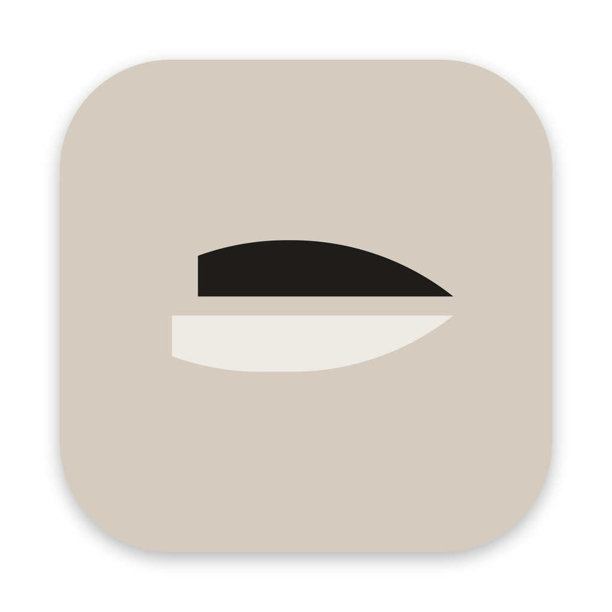

<p align="center">
  <picture>
    <source media="(prefers-color-scheme: dark)" srcset="assets/Keel-alt.png">
    
  </picture>
</p>

<h1 align="center">Keel</h1>

<p align="center">
  <strong>Local-first control plane and native workspace for coding-agent CLIs.</strong>
</p>

<p align="center">
  <a href="#overview">Overview</a> •
  <a href="#downloads">Downloads</a> •
  <a href="#key-features">Key Features</a> •
  <a href="#architecture">Architecture</a> •
  <a href="#workspace-crates">Workspace Crates</a> •
  <a href="#getting-started">Getting Started</a> •
  <a href="#development">Development</a> •
  <a href="#license">License</a>
</p>

---

## Downloads

Download the latest pre-built application for macOS:

| Platform | Format | Size | Download |
|---|---|---|---|
| **macOS** (Apple Silicon / arm64) | **Tar XZ Archive** (Smallest) | **153 MB** | [**Keel-0.2.6-macos-arm64.tar.xz**](https://github.com/Wasomeno/keel/releases/download/v0.2.6/Keel-0.2.6-macos-arm64.tar.xz) |
| **macOS** (Apple Silicon / arm64) | **DMG Installer** | **326 MB** | [**Keel-0.2.6-macos-arm64.dmg**](https://github.com/Wasomeno/keel/releases/download/v0.2.6/Keel-0.2.6-macos-arm64.dmg) |
| **macOS** (Apple Silicon / arm64) | **Zip Archive** | **237 MB** | [**Keel-0.2.6-macos-arm64.zip**](https://github.com/Wasomeno/keel/releases/download/v0.2.6/Keel-0.2.6-macos-arm64.zip) |

*See all assets and checksums on the [Releases page](https://github.com/Wasomeno/keel/releases).*

> **Note on First Launch:** This build is signed with a self-signed certificate, not notarized. Move `Keel.app` to `/Applications`, open it once, then go to System Settings → Privacy & Security and click **Open Anyway**. From 0.2.4 on, Keel updates itself in place from Settings → Updates.

---

## Overview

**Keel** is a local-first control plane and native workspace for coding agents. It is not an LLM wrapper or web-based chat client; it is an operating environment for developer agents running directly on your Mac.

One local engine owns and supervises child agent processes (a bundled agent runtime powered by a pinned [Pi](https://pi.dev) release with extensions for web access, subagents, and model providers), normalizes agent outputs into a structured `AgentEvent` stream, and persists conversation histories to durable [Loro CRDT](https://loro.dev) documents backed by SQLite. A native macOS GPUI window acts as an ultra-fast, responsive viewport onto that engine.

- **Local-Only & Private:** No cloud account or external servers required. All session histories, transcripts, and workspaces stay strictly on your local machine.
- **Process Supervision:** Manages the full agent lifecycle, process groups, watchdog timers, and signal escalation (`SIGTERM` / `SIGKILL`).
- **Durable Command Plane:** User inputs, steer commands, interruptions, and questions are appended to an append-only CRDT log, ensuring state resilience across restarts and crashes.
- **Native Performance:** Built in Rust using GPUI with a virtualized transcript, streaming markdown, and minimal resource usage.

---

## Key Features

- **Unified Agent Runtime:** Runs a bundled agent engine (powered by a pinned Pi core) with native multi-provider sign-ins (Claude Pro/Max, OpenAI ChatGPT/Codex, GitHub Copilot, xAI, Command Code), extension UI, and subagent delegation.
- **Virtualized High-Performance Transcript:** Smooth scrolling with bottom stickiness, partial re-parse streaming markdown via `pulldown-cmark`, and background syntax highlighting with `syntect`.
- **Structured Tool Call Rendering:** Full tool inputs and outputs are preserved in host-local run journals, while concise summaries are stored in the CRDT document to maintain lightweight document sizes.
- **Interactive Question & Approval System:** First-class permission panels and interactive choices (`UserInputQuestion`) mapped directly from agent approval flows.
- **Chromium Embedded Browser (CEF):** Integrated Chromium Embedded Framework viewport with dedicated helper processes (`keel-helper`) for live web previews and agent-driven browser automation via MCP.
- **Native Diagrams & Terminal:** In-process Mermaid diagram rendering via `merman` and `resvg` (pure Rust, no Node.js runtime needed) and integrated terminal panels via `alacritty_terminal`.
- **Flexible Deployment:** Run as a native macOS GUI application, in headless mode via CLI (`keel headless`), or as a background service (`launchd`).

---

## Architecture

Keel is architected around a clean separation between the engine supervisor and viewports:

```
┌────────────────────────────────────────────────────────┐
│                      Native GPUI                       │
│  (Sidebar • Transcript • Composer • CEF Browser Pane)  │
└───────────────────────────┬────────────────────────────┘
                            │
               WebSocket / In-Process RPC
                            │
┌───────────────────────────▼────────────────────────────┐
│                      Keel Engine                       │
│ ┌────────────────────────────────────────────────────┐ │
│ │ Supervisor • Watchdog • Run Journal • Doc Host     │ │
│ └─────────────────────────┬──────────────────────────┘ │
│                           │                            │
│ ┌─────────────────────────▼──────────────────────────┐ │
│ │      Loro CRDT Documents (Session & Registry)      │ │
│ │         SQLite Snapshots (Profiles / Local)        │ │
│ └────────────────────────────────────────────────────┘ │
└───────────────────────────┬────────────────────────────┘
                            │ Stdio RPC
┌───────────────────────────▼────────────────────────────┐
│      Bundled Agent Process (Pi Core + Packages)        │
└────────────────────────────────────────────────────────┘
```

- **Single-Instance Safety:** Uses file locking (`engine.lock`) before opening SQLite databases, guaranteeing safe concurrent processes.
- **RPC Layer:** Viewports connect via local authenticated WebSocket (`ws://127.0.0.1:47821`) or an in-memory duplex channel.

---

## Workspace Crates

The repository is organized as a Rust workspace with strict dependency directions:

| Crate | Path | Description |
|---|---|---|
| `keel` | `apps/keel` | Main application; headed GPUI window, helper binaries, headless engine, and CLI |
| `keel-proto` | `crates/proto` | Protocol types, wire envelopes, agent events, and serialized models |
| `keel-doc` | `crates/doc` | Loro 1.13 CRDT document structures for transcripts, meta, and registry |
| `keel-store` | `crates/store` | Local SQLite snapshot persistence and document storage |
| `keel-harness` | `crates/harness` | Agent harness, process lifecycle, and provider authentication |
| `keel-engine` | `crates/engine` | Process supervisor, command drain, journal writer, and recovery handlers |
| `keel-rpc` | `crates/rpc` | Authenticated IPC WebSocket server/client and length-prefixed duplex codec |
| `keel-theme` | `crates/theme` | Semantic design tokens, light and dark themes, and appearance palettes |
| `keel-ui` | `crates/ui` | GPUI elements: virtualized transcript, markdown renderer, tabs, composer, terminal, and CEF browser pane |

---

## Getting Started

### Prerequisites

- **macOS** (Apple Silicon or Intel)
- **Rust Toolchain**: Rust 2024 edition (defined in `rust-toolchain.toml`)
- **Xcode Command Line Tools**

### Building from Source

```bash
# Clone the repository
git clone https://github.com/Wasomeno/keel.git
cd keel

# Build in debug mode
cargo build -p keel

# Run Keel
cargo run -p keel
```

### Running as a macOS App Bundle

To enable native macOS notification banners and URL scheme routing (`keel://`), bundle Keel into a release application:

```bash
# Build optimized release binary (~30 MB)
cargo build --release -p keel

# Bundle and ad-hoc sign into ~/Applications/Keel.app
scripts/bundle-mac.sh

# Run the app
open ~/Applications/Keel.app
```

---

## Development

```bash
# Run tests across core crates
cargo test -p keel -p keel-ui -p keel-engine

# Run headless engine
cargo run -p keel -- headless

# Inspect running engine status
cargo run -p keel -- status
```

---

## Documentation

- [assets/brand/USAGE.md](assets/brand/USAGE.md) — Brand guidelines and mark specifications.

---

## License

This project is licensed under the Apache License 2.0.
