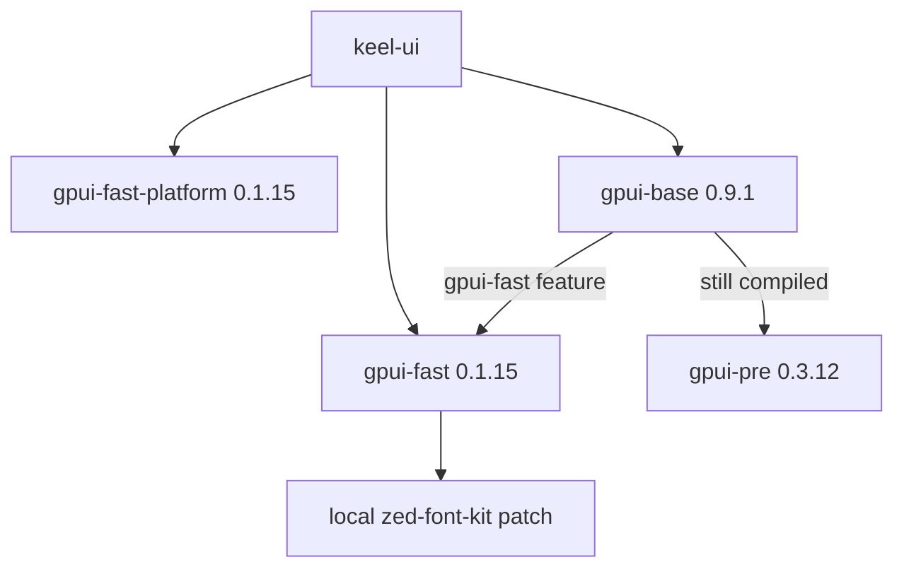

# GPUI Fast migration

Status: implemented on `migrate/gpui-fast` (2026-11-15). Compile, tests,
release build, headless/status, and the sidebar frame comparison pass. The
validation gaps and unmeasured scenarios are recorded below instead of being
claimed as verified. `main` remains on the previous zui pins.

## Why

Keel's GPUI surface is one crate (`crates/ui`); the engine, protocol, store,
RPC, harness, and theme crates do not depend on GPUI. That made a direct
dependency migration practical instead of a rewrite.

[gpui-fast](https://github.com/longbridge/gpui-fast) is a retained-mode fork
of upstream GPUI, not a different toolkit. It keeps the public GPUI API while
adding incremental view rebuilding, persistent Taffy layout, cached glyph and
path work, scroll layers, and native window composition. The published
`gpui-fast` and `gpui-fast-platform` crates are Apache-2.0. `gpui-base` 0.9.1
is built against the same line and provides the input/editor, theme, selection,
and shadow APIs Keel uses. Keel depends on `gpui-base` directly rather than
adopting GPUI Kit or `gpui-component`.

## Versions

| Crate | Version | Source | Notes |
| --- | --- | --- | --- |
| `gpui` (package `gpui-fast`) | `=0.1.15` | crates.io | Apache-2.0 |
| `gpui_platform` (package `gpui-fast-platform`) | `=0.1.15` | crates.io | features `wayland`, `x11`, `font-kit`, `runtime_shaders` |
| `gpui-base` | `=0.9.1` | crates.io | feature `gpui-fast` |
| `gpui-pre` | `0.3.12` | crates.io | transitive through `gpui-base`; compiled, not used at runtime |
| `zed-font-kit` | `0.14.1-zed` | local `patches/font-kit` | MIT OR Apache-2.0; source byte-identical to the crate |



`gpui-pre` is the expected double-compile tradeoff. It is not linked by Keel's
views, but `gpui-base` declares it non-optionally.

## Code changes

- Manifests alias `gpui-fast` / `gpui-fast-platform` as `gpui` / `gpui_platform`
  and pin all three direct dependencies exactly.
- `crates/ui/src/gpui_tokio.rs` replaces the zui `gpui_tokio` crate with the
  three functions Keel used: `init`, `init_from_handle`, and `Tokio::handle`.
  The owned runtime shuts down in the background on drop.
- `Window::paint_image` gained fitted `image_bounds`. Keel passes the same
  bounds for both arguments, preserving the old draw. Three call sites changed:
  the CEF pane, the transcript's images, and the Mermaid viewer.
- `paint_backdrop_blur` does not exist. The settled chat's foot glow keeps its
  gradient bands and `CHAT_GLOW`, but the 48 px blur is gone.
- `Theme.resizable.handle` and `active_handle` are `Option<Hsla>`; Keel sets
  `Some(...)`.
- gpui-fast's static keybinding parser does not resolve the `secondary-` alias
  (`KeyBinding::load` does, but it needs an `App`). `keys.rs` expands
  `secondary-` to `cmd-` on macOS and `ctrl-` elsewhere at compile time, which
  preserves the old semantics and keeps the table static and testable.
- `ScrollWheelEvent` / `on_scroll_wheel` were renamed to `ScrollEvent` /
  `on_scroll`; Keel uses the new names.
- The `zed-font-kit` patch moved from the zed-industries git source to
  `[patch.crates-io]` because gpui-fast resolves the crate from crates.io. The
  local manifest preserves the previous dependency set (`dirs` 6,
  `freetype-sys` 0.23) rather than the published crate's `dirs` 5 /
  `freetype-sys` 0.20; the source is byte-identical.

## Known gaps

- **No backdrop blur.** gpui-fast has no equivalent of
  `paint_backdrop_blur`. The foot glow remains; the blur is the only intentional
  visual change.
- **`gpui-pre` doubles the build.** `gpui-base` 0.9.1 declares it
  non-optionally. A local `gpui-base` patch that makes it optional is a
  follow-up, not part of this migration.
- **Retention gains are conditional, and the sidebar A/B shows none.** `KeelWindow`
  is one large entity (`crates/ui/src/view/main_pane.rs`), so notifying it rebuilds
  the window. The 5-toggle sidebar run produced 95 frames with no consistent
  gap/layout/painted improvement whether view retention and scroll layers were
  on, off individually, or off together (see Measurements). The frame-time win
  over the zui baseline comes from the gpui-fast core, not from retained child
  views. Extracting subviews is the follow-up that would give retention
  something to reuse.
- **Memory was not a clean gate.** With the CEF pane open, RSS samples ranged
  from 117 MB to 355 MB across otherwise identical runs; the CEF helper and
  shared-memory variance was larger than any retention delta. The migration did
  not change the process model or the CEF lifetime. A dedicated memory harness
  is a follow-up before claiming a memory win or regression.
- **Ctrl+Cmd+F does not toggle fullscreen.** gpui-fast's native green button
  enters and leaves fullscreen correctly, and the layout adapts. The standard
  macOS menu shortcut did not toggle it in this build; whether that is a missing
  menu item or an unbound action is a gpui-fast follow-up, not a blocker for the
  window itself.
- **`triple_buffer()` stays.** gpui-fast's macOS display link may already pace
  drawables; the three-drawable override rendered correctly in the smoke run
  and is kept as the known-good setting.

## Retention rules

gpui-fast exposes two runtime switches for A/B measurements:

- `GPUI_VIEW_RETENTION=0` disables retained view rebuilding
  (`Window::set_view_retention`).
- `GPUI_SCROLL_LAYERS=0` disables scroll layers
  (`Window::set_scroll_layers`).

Both default to on. The migration leaves those defaults alone. A controlled
sidebar A/B produced 95 frames in all three configurations (both on,
`GPUI_VIEW_RETENTION=0`, and `GPUI_SCROLL_LAYERS=0`), with gap p50 within
0.3 ms and p95 within 1.6 ms; retention did not measurably reduce frame work.
The toggles stay available for the subview follow-up.

When retention is on, render-time state must be stable and observable: read
`Cell`/`RefCell` values during paint, but call `cx.notify()` only when the
underlying value changes. A mutation that the entity does not observe can leave
a retained node stale. The migration introduced no new render-time mutation;
the `GPUI_VIEW_RETENTION=0` A/B run is the guard for the existing state, and any
stale node found there is a bug to fix before removing the toggle.

## Validation

The migrated build was exercised through the real window, the debug
`ui-dev.sock` driver, and the CEF pane. Commands:

```sh
cargo fmt --check
cargo check -p keel-ui
cargo check -p keel
cargo test -p keel -p keel-ui -p keel-engine
cargo clippy -p keel-ui --all-targets
cargo build --release -p keel
target/debug/keel headless   # temp KEEL_DATA_DIR and KEEL_IPC_PORT
target/debug/keel status
```

`cargo fmt --check` exits 1 on formatting differences in files that predate
this migration (for example `apps/keel/build.rs`, `apps/keel/src/main.rs`, and
`apps/keel/src/mcp_browser.rs`); the migration does not reformat unrelated
code, and the new `gpui_tokio.rs` and the rewritten `keys.rs` pass
`rustfmt --check`. `cargo test`
reports 391 passed in `keel-ui` and 162 in `keel-engine`, plus 9 unit and 1
integration test in the binary; one test is ignored in each of `keel-ui` and
`keel-engine`, with no failures. clippy completes with
the existing style warnings in `keel-ui` and no errors. The release build
finished in 1m39s on the second run. Headless and status were run with the
debug binary on a temporary data directory and port; `status` printed
`scope: local`, a device id, and `live_runs: 0`.

Smoke matrix (debug bundle, copied profile, separate `KEEL_IPC_PORT`). The
"checked" column lists only what was actually driven; gaps are listed after
the table and are not claimed as verified.

| Area | Checked | Result |
| --- | --- | --- |
| Window | opens; resize to 700×500; minimum clamp 640×420; 1.25 zoom; fullscreen via the native green button; `dev_control::redraw` | pass for these. Ctrl+Cmd+F did not toggle fullscreen; titlebar drag/double-click not scripted. |
| Sidebar | open/collapse, five-toggle animation, spaces/chats and attention rows render | pass for these; folding, hover, and context menus not scripted. |
| Transcript | markdown, code table, tool and file-change cards, user message, images, Mermaid viewer, lightbox in both themes | pass for these; selection/copy, stick-to-bottom, and syntax-highlight detail not scripted. |
| Composer | typing; send; running/steer render; permission, effort, and slash-command menus; prompt suggestion | partial. Stop, IME, selection, and question panel not exercised; pickers render but values were not changed. |
| Settings | settings page (theme, reduced motion, updates, notifications), skills page after restoring Pi, dark/light, zoom | rendered; toggles and settings-list scroll not exercised. |
| Right panels | browser/CEF, terminal prompt, changes panel, new-tab launcher, file tab | partial. The changes panel reported that the chat's files are on another device; GitLab/MR, Dotify, and memory panels not scripted. |
| CEF | pane opens, example.com navigates, tab bar and new-tab launcher, screenshot | pass for these; upload, dialog, agent tools, close/park not scripted. |
| Accessibility | launched with `GPUI_A11Y_ACTIVE=1`; window, engine, and dev socket up | launch-only; VoiceOver navigation not performed. |

Not driven: the question panel and a real send/steer/stop run need an
authenticated model turn; no dev command creates one, and no live model
credentials were used in this environment. The `live on` / `live_start`
commands are render-only: they make the last turn look running but do not set
the chat status the composer reads. IME, text selection/copy, CEF
upload/dialog/agent tools, and the GitLab/Dotify/memory panels are also
unverified. The settings toggles and settings-list scroll were rendered but not
changed. These are follow-ups, not passes.

Expected visual differences: the removed foot blur, plus possible subpixel
text and scroll snapping. The migrated app opens the chat at the bottom of the
transcript; the baseline opened at a layout-dependent offset. That is
consistent with the bottom-aligned transcript and is recorded as a behavior
difference, not a regression. No other visual regression was found in the
captured matrix.

## Measurements

Baseline: zui `0966d065` + `gpui-base` `4764fd00`, debug build, 1100×720 @2x,
copied local profile. Migrated: gpui-fast `0.1.15` + `gpui-base` `0.9.1`, same
window, profile, and script. Frame values are from `KEEL_FRAME_LOG=1` during
the sidebar animation; CPU and RSS are sampled with `ps`.

| Scenario | Metric | Baseline | Migrated |
| --- | --- | --- | --- |
| Sidebar toggle, 5× | frames | 42 | 95 |
| Sidebar toggle | gap p50 / p95 (ms) | 58.4 / 141.5 | 33.4 / 40.5 |
| Sidebar toggle | layout p50 / p95 (ms) | 21.9 / 93.1 | 4.7 / 15.9 |
| Sidebar toggle | painted p50 / p95 (ms) | 24.8 / 99.0 | 6.0 / 17.8 |
| Sidebar toggle | CPU seconds / 5 toggles | not captured | 1.18–1.23 |

The sidebar run is the clear improvement that justifies the swap: 2.26× the
frames, 43% lower gap p50, 71% lower gap p95, and roughly 80% lower layout and
painted p95. It is also the only scenario with a complete baseline. The old
debug bundle was overwritten when the migrated bundle was refreshed, so the
scroll, streaming, and CEF CPU rows below are marked not captured rather than
compared against a second zui build in a different environment.

| Scenario | Metric | Baseline | Migrated |
| --- | --- | --- | --- |
| Sidebar, `GPUI_VIEW_RETENTION=0` | frames / gap p50 / p95 | n/a | 95 / 33.4 / 40.4 |
| Sidebar, `GPUI_VIEW_RETENTION=0` | layout p50 / p95 | n/a | 4.8 / 13.7 |
| Sidebar, `GPUI_VIEW_RETENTION=0` | painted p50 / p95 | n/a | 6.0 / 14.6 |
| Sidebar, `GPUI_SCROLL_LAYERS=0` | frames / gap p50 / p95 | n/a | 95 / 33.6 / 41.9 |
| Sidebar, `GPUI_SCROLL_LAYERS=0` | layout p50 / p95 | n/a | 5.0 / 15.5 |
| Sidebar, `GPUI_SCROLL_LAYERS=0` | painted p50 / p95 | n/a | 6.1 / 17.3 |
| Memory, chat + browser, CEF open | RSS (MB) | 204 (one sample) | 117–355 (run variance; not attributable to retention) |
| Long transcript scroll | CPU seconds / 20 commands | not captured | not captured |
| Streaming (`live on`) | CPU seconds / 5 s | not captured | not captured |
| CEF page | CPU seconds / 5 s | not captured | not captured |

Retention on, retention off, and scroll layers off are within noise of each
other in the sidebar scenario; the toggles do not reduce work for the
monolithic `KeelWindow`. The memory range is too wide to call a win or a
regression, and the scroll, streaming, and CEF scenarios have no baseline. The
only gate that can be stated as passed is the sidebar frame-time comparison.
Raw frame logs and migrated samples are kept outside the repository under
`$TMPDIR/keel-gpui-fast-baseline/` and `$TMPDIR/keel-gpui-fast-after/`.

## Rollback

- All migration work stays on `migrate/gpui-fast`; `main` remains on zui.
- To abandon: switch back to `main`, clean the target, and rebuild under the
  old pins. No remote history is rewritten.
- If only `0.1.15` fails, try `gpui-fast` / `gpui-fast-platform` `=0.1.14`
  before abandoning the migration, and record the reason in this file.
- Do not push.
